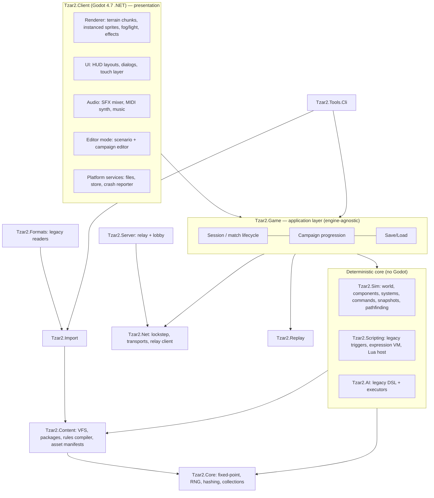

# Tzar2 — Technical Design Document & Technical Task

| | |
|---|---|
| **Document** | Technical Design Document (TDD) + Technical Task for the rebuild of *TZAR: The Burden of the Crown* (2000) on a modern stack |
| **Version** | 1.0 — 2026-10-11 |
| **Intended reader** | The implementation agent(s) that will reverse engineer the original, build the new game, the campaign/scenario editor, and the modding platform |
| **Codename** | `Tzar2` (repository name). Root .NET namespace: `Tzar2.*`. Public product name is **not** decided (see Q-01, trademark). |
| **Repository** | `github.com/dx125/Tzar2` (public) |
| **Release scope** | **1.0 = Windows only.** macOS, Linux, Android and iOS are planned for the post-1.0 platform-expansion phase, after the initial success of the Windows release (DEC-14). |
| **Original install used for research** | `Origin/` in this repo (local only — **must never be committed**, see REQ-LEGAL-01) |
| **Appendices** | [A – Original install inventory](tdd/A-original-install-inventory.md) · [B – Legacy data & formats reference](tdd/B-legacy-data-and-formats.md) · [C – Legacy trigger system](tdd/C-legacy-trigger-system.md) · [D – Legacy AI script DSL](tdd/D-legacy-ai-dsl.md) · [E – Gameplay content catalog](tdd/E-gameplay-content-catalog.md) · [F – References & sources](tdd/F-references.md) · [G – Review recommendations (proposed)](tdd/G-review-recommendations.md) |

---

## 0. How to use this document

1. Read sections 1–7 completely before writing code. They contain the binding decisions.
2. Sections 8–21 are the subsystem specifications. Each has **requirements** (`REQ-*`), **acceptance criteria**, and, where the original's behaviour is not yet known, **unknowns** that the reverse-engineering (RE) work plan in §23 resolves.
3. §25 defines milestones. Work milestone by milestone; do not start a milestone before the exit criteria of its prerequisites are met.

### 0.1 Normative language
`MUST` / `MUST NOT` = mandatory. `SHOULD` = strong default; deviations must be recorded in `docs/decisions/` as an ADR. `MAY` = optional.

### 0.2 Identifier scheme
| Prefix | Meaning |
|---|---|
| `DEC-nn` | Binding architectural/product decision |
| `REQ-<AREA>-nn` | Requirement (areas: LEGAL, ARCH, SIM, PATH, GAME, DATA, IMP, GFX, AUD, UI, AI, SCR, EDT, NET, PLAT, PERF, TEST, RE) |
| `ORIG-nn` | Known defect/limitation of the original game that the rebuild must fix |
| `UNK-nn` | Unknown about the original that must be resolved by RE (§23.4) |
| `RISK-nn`, `Q-nn` | Risks, open questions for the product owner |

### 0.3 Source-of-truth priority (when facts conflict)
1. Behaviour **measured in the running original game** (black-box observation, instrumentation).
2. Original **data files** (INI/TXT tables, AI scripts) of the *clean* reference build (GOG v1.10 English, verified against `docs/original-build/manifests/gog-1.10-en.reference.tsv`).
3. Original **manuals** (`manual.pdf`, `Editor_Manual.pdf`, `Strategy_Guide.pdf`) and official patch notes (`TZAR110.TXT`).
4. Community knowledge (Appendix F).
5. Statements in this document marked **⚠ HYPOTHESIS**.

> **Reference build:** GOG v1.10 English (build `49982740489443525`, 2017-03-15), 2,916 files. Its manifest (paths, sizes, MD5) is in [`docs/original-build/`](original-build/README.md). The local `Origin/` folder is a third-party repack: 2,859 files are byte-identical to the reference, 57 are modified (Russian localization “Огнем и мечом”, HD patch, user settings), and there are 150 non-original extras (HD patch, utilities, FX campaigns, crash logs). It is fine for format research, but **balance values MUST be validated against the clean reference files** before being declared "Classic" (REQ-RE-03).

---

## 1. Executive summary

We will rebuild *TZAR: The Burden of the Crown* as a modern, cross-platform, moddable RTS that **looks and plays like the original** while fixing its well-known technical problems.

* **Stack:** a pure, deterministic **C# simulation core** (no engine dependency) + **Godot 4.7 (.NET)** for rendering, audio, input, UI and the editor.
* **Platforms:** **the first release (1.0) is Windows only.** macOS, Linux, Android and iOS (tablet-first; phones supported) are planned and will be added in a post-1.0 *platform expansion* phase, after the Windows release succeeds (DEC-14). The architecture is cross-platform-ready from day one, so those ports need no rewrites.
* **Multiplayer:** deterministic **lockstep** over UDP with a relay server; **replays** are command logs; desync detection built in.
* **Assets:** **imported at first run from the player's own legitimate copy** (GOG/Steam/CD). The repository and builds ship **no** original assets or code.
* **Authentic look:** original 15‑bit (RGB555) sprites reproduced pixel-exactly, integer scaling by default, original HUD layouts reproduced; modern resolutions and optional enhancements are opt-in.
* **Fixes:** corpse-blocked terrain, group pathfinding, depth-limited pathfinding, big-map performance, network desyncs and fragility, crashes, resolution limits, exploits (full list §5).
* **Editor:** a full scenario and campaign editor with feature parity with the original `TzarEdit.exe` and `TzarCampaign.exe` (rules/events/actions, conversations, user resources, persistent heroes), plus modern additions (undo/redo, live validation, playtest, trigger debugger, campaign graph, Lua scripting) and a **built-in converter for original, FX and community `.wmp`/`.wcm` maps and campaigns** that users keep locally.
* **Extensibility:** composable “traits” (behaviours) driven by data, YAML rules with inheritance and patching, a virtual file system with mod packages, sandboxed Lua, and a legacy compatibility layer (original triggers and AI scripts).

---

## 2. Binding decisions

| ID | Decision | Rationale |
|---|---|---|
| **DEC-01** | Presentation engine: **Godot 4.7.x stable, .NET edition**. Pin the exact patch version in `global.json`/CI; upgrade minor versions only via ADR. | Product owner's choice. MIT license, strong 2D, built-in UI toolkit for the editor, C# support on desktop and mobile. |
| **DEC-02** | The simulation, data, formats, scripting, AI, networking and replay layers are **plain .NET class libraries with zero references to Godot**. They are testable headless and reusable by the dedicated relay server and CLI tools. | Determinism, testability, engine independence, and a headless server. |
| **DEC-03** | Target platforms: Windows x64, macOS (arm64 + x64), Linux x64, Android arm64, iOS arm64, **delivered in phases per DEC-14** (Windows first). **Web is out of scope**: Godot cannot export C# projects to the web (as of 4.7). | Product owner's choice and engine constraints. |
| **DEC-04** | **Deterministic fixed-point integer simulation**. No `float`/`double` in sim state or sim logic. | Lockstep MP and replays across x64/ARM64 and OSes. |
| **DEC-05** | **No original assets or original code in the repo or in builds.** An importer converts the user's own installation. | Legal (the IP is owned by third parties; see §3.7). The OpenRA / fheroes2 / OpenRCT2 model. |
| **DEC-06** | Gameplay is defined by **rulesets**. `classic` reproduces v1.10 behaviour (the GOG reference build; 1.11 differences documented when available, Q-02). Engine defects (§5) are fixed in **all** rulesets. Gameplay-affecting quirks are preserved in `classic`, but each must be individually toggleable in the rules. A `remastered` ruleset adds QoL and balance fixes. | Fidelity for purists plus freedom for redesign. |
| **DEC-07** | **Visual authenticity first**: pixel-exact sprites, nearest-neighbour sampling, integer scaling by default, original HUD reproduced. Smoothing filters, upscaled packs and new UI layouts are opt-in. | Product owner's requirement. |
| **DEC-08** | **Lockstep over UDP via a relay server** (star topology; the relay orders and forwards commands, it does not simulate). Transport: LiteNetLib (MIT). Optional Steam Networking transport when shipped on Steam. | NAT-free connectivity, deterministic ordering, cross-platform. |
| **DEC-09** | Code license stays **MIT** (existing `LICENSE`). Runtime dependencies MUST be MIT/BSD/zlib/Apache-2.0/MPL-2.0. **GPL code (OpenRA, QuickBMS, etc.) may be read as a reference but MUST NOT be copied or linked.** | License hygiene. |
| **DEC-10** | Sprites are rendered by **batched instancing** (RenderingServer/MultiMesh + texture arrays), **not** one Godot Node per entity. | Thousands of units on mobile. |
| **DEC-11** | The editor is a **separate app mode of the same Godot client** and shares the game renderer and the sim (WYSIWYG, instant playtest). Desktop-first. | Single renderer, single source of truth. |
| **DEC-12** | **Original save games (`.wsv`) and demos (`.wdm`) are not supported** (stretch goal only). Original maps (`.wmp`) and campaigns (`.wcm`) **are** supported via conversion. | Bit-exact replay of the original simulation is not realistic; maps and campaigns are the valuable content. |
| **DEC-13** | Scripting: (a) the **legacy trigger system** is re-implemented exactly; (b) **Lua 5.2 (pure C# interpreter, AOT-safe)** for new content; (c) compiled C# trait modules for deep extensions (built into the game, or loaded dynamically on desktop only). | Compatibility, safety, iOS AOT constraints. |
| **DEC-14** | **Release phasing: version 1.0 ships for Windows x64 only.** macOS, Linux, Android and iOS support is planned, but it is delivered in the post-1.0 **Platform expansion (PX)** phase, which starts only after the initial success of the Windows release (product-owner decision). Until then: (a) the cross-platform **architecture constraints still apply** (engine-agnostic core DEC-02, integer determinism DEC-04, AOT/trimming-safe code REQ-ARCH-02, platform services behind interfaces REQ-PLAT-01, data-driven UI layouts that can host touch layouts); (b) the core libraries' determinism is still verified headless on Linux x64 and macOS arm64 in CI (cheap insurance for the later ports); (c) **no platform-specific deliverables** for non-Windows platforms are required for 1.0: no builds, store presence, touch UX, mobile import flow or mobile performance tuning. | Focus effort on one platform until the product is validated, while keeping later ports cheap. |

---

## 3. The original game — research findings

### 3.1 Key facts

| Item | Value | Source |
|---|---|---|
| Title | TZAR: The Burden of the Crown (RU: “Огнем и мечом”; ES: FX Interactive editions incl. *Edición de Oro*) | manuals, `LOCAL/STRINGS.INI` |
| Developer / publisher | Haemimont (Sofia, BG) / TalonSoft (Take-Two), 2000. Trademark notice: Infinite Loop / PAN Interactive. Currently published on GOG (2013-07-16) and Steam (2019-06-06, app 825730) by Haemimont Games. | manual p.2, Wikipedia |
| Final official version | **1.10** (EXE build 2002-03-02, per the crash-log header “Tzar Version: 1.10, 2/03/2002”). GOG ships 1.10 for EN/DE/ES (build 2017-03-15) and 1.01/1.01A for PL/PT. **1.11 = *Gold Edition / Anthology*** (FX Interactive, 2002, Spain/Italy only, with 4 extra voiced campaigns; not sold digitally). Steam threads also mention 1.11 (to be fingerprinted). Community: **1.13b** (Polish balance mod, 2008). | `Origin/Logs/*/error.log`, `TZAR110.TXT`, GOG content-system manifests, PlayTzar |
| Platform/tech | Win32, **DirectDraw**, **16-bit high-color** (min 800×600), DirectSound, DirectPlay-era networking (IPX/TCP), GameSpy Arcade (1.09). Needs a `16BitColor` compatibility shim or a DirectDraw wrapper (cnc-ddraw) on modern Windows. | manual, HD patch source, GOG forum |
| Native resolutions | 800×600 and 1024×768 HUD layouts (bottom/left/right panel variants in `DATA/LAYOUT.INI`). Widescreen only through binary-patched EXEs (community HD patch). | `LAYOUT.INI`, `resolutions/` |
| Players | Up to 8 kingdoms + “Rescue” and “Nature” pseudo-players | Editor manual §1.2 |
| Map sizes | Tiny 64², Small 96², Medium 128², Large 192², Huge 256², Enormous 384², Real World 512² (tiles) | Editor manual §2 |
| Tile grid | **Orthogonal square grid, 32×32 px tiles** (not isometric). Terrain is blended with **corner-based transition tiles: 14 combinations × 2 variants** per terrain pair; shores have 4 animation frames. | `IMAGES/TERRAIN/*.TERRAIN.INI`, BMP sizes |
| Color depth of art | **15-bit RGB555** (RLE headers carry the 0x7C00/0x03E0/0x001F masks; BMPs are 16 bpp BI_RGB) | file headers |
| Units | **8 facing directions** (`cols = 8`), N frames per animation (`rows`), per-frame delays in ms (`delay` values sum to `anim_time`), hit frame `actionrow`. Separate walk / attack / idle / die sheets. | `DATA/IMAGES.INI` |
| Civilizations | European, Asian, Arabian (+ common units/buildings, magic creatures) | manual §V.4 |
| Development paths | War (Warriors' Guild/Academy), Religion (Cathedral/Mosque/Shao Linn), Magic (Mage Tower), Trade (Merchants'/Traders' Guild) | manual |
| Signature features | Full experience system for every unit (level 12 → named hero), item inventories, building capture by peasants, heroes/mercenaries in taverns, loans/gambling, trade caravans, magic gateways, day/night, weather | manual, Wikipedia |
| Content volume (this install) | 87 technologies, 12 upgrades, 699 image definitions, 293 orders, 240 icons, 136 object classes, 438 WAV sounds, 14 MIDI tracks, 3 DDV movies, 4 terrain sets | counted |

### 3.2 Install anatomy (summary; full inventory in Appendix A)

```
Tzar.exe (1.75 MB)        game        TzarEdit.exe/.dll   map editor     TzarCampaign.exe  campaign packer
Tzar.dll, TZAREXT.DLL     resources/extensions                 Setup.exe, manuals (PDF)
DATA/                     INI + TSV rule tables, AI scripts (DATA/AI), object classes (DATA/OBJECTS)
IMAGES/{UNIT,BUILDING,ANIMS,TERRAIN,SCENERY,ICONS,ITEMS,ORDERS,CURSORS,SCREENS,RANDOMMAP}  ~180 MB
SOUND/<17 categories>/*.WAV (22050 Hz, 16-bit, mono)     MUSIC/*.MID (14)     MOVIES/*.DDV (3)
LOCAL/                    string tables (codepage-specific), bitmap fonts (*.FNT)
HELP/                     in-game help text/images
Maps/*.wmp  Campaign/*.wcm  Save/*.wsv  Demos/*.wdm  Logs/<id>/error.log + error.bmp
tzar.ini                  user settings (video/sound/layout/scroll/weather/day-night)
```

File containers identified (details in Appendix B):

| Ext/magic | Purpose | Knowledge level |
|---|---|---|
| `.wdt` — `"HMMSYS PackFile"` (optionally wrapped in `"LZSS"` chunked compression) | Data packs (GOG PL/PT editions ship `Packs/{data,help,images,local,movies,sounds,terrains,v101}.wdt`; the 1.13b mod replaces `Data.wdt`); loose files override packs | **Documented** by the community (QuickBMS `tzar.bms`; Arch.exe) |
| `.wmp`, `.wcm` — `"HPFS"` container (`.wsv` saves ⚠ presumably the same; no sample available) | Map / campaign (/ save). Campaigns embed maps plus user resources (BMP/WAV/MID). Fan campaigns reach 120 MB. | Container partly visible (embedded file names); internals **unknown** (UNK-04) |
| `.wdm` — `"medt"` | Recorded demo/replay | Unknown (not needed, DEC-12) |
| `.RLE` — `" elr"` + `"RLE\0"` header | Run-length-encoded 15-bit sprite sheets (directions × frames) | Community converter exists (RLEsBMPs); format **to be specified** (UNK-01) |
| `.DAT` (next to RLE) | Per-frame metadata (offsets/boxes) / building footprint data | Unknown (UNK-02) |
| `.BMP` 16 bpp | Terrain, UI, some effects; `IMAGES.INI` references `.bmp` names that resolve to the `.RLE` cache (“RLE First” setting) | Standard |
| `.DDV` — `"DDV\0"` | Video, 320×240 @ 25 fps, with a frame offset table | Unknown (UNK-05) |
| `.FNT` | Bitmap fonts (“Small Fonts”, Arial AA…) | Unknown, simple (UNK-06) |
| `GAME.PAL` — `"PALF"` + 256×4 bytes | 256-color palette (use unclear: minimap/player colors?) | Partly |

### 3.3 Data-driven vs. hardcoded in the original

**Data-driven (text files we can import directly):**
* Unit & building stats per civilization: `DATA/{EURO,ASIA,ARAB,COMM} {UNITS,BUILDINGS}.TXT` (tab-separated: class, cost, time, sight, range, health, attack, defence, speed, rate, producer, tech dependency; buildings add resistance and an “EMIT (own/other)” column).
* Technologies (`TECHNOLOGIES.INI`: time in ms, cost), upgrades (`UPGRADES.INI`), per-civ tech trees (`TECHTREE *.INI`), damage bonus matrix with unit groups (`BONUS.INI`), starting/map resources (`RES.INI`), hero names (`HEROES.INI`), taunts, equations (`EQUATIONS.INI`).
* Object definitions (`DATA/OBJECTS/*.INI`): per-civ image/sound/icon/menu bindings, holder capacity, damage-distribution rules (`[damage] 00=sword, 01=arrow, 02=cannon`), accepted contents. **Each object binds to a hardcoded engine `class`.**
* Visuals: `IMAGES.INI` (sprite sheets, pivots, selection boxes, frame timing), terrain sets (`*.TERRAIN.INI`, `*.IMAGES.INI`), icons, orders/command cards (`ORDERS.INI`, `MENU.INI`), hotkeys (`KEYS.INI`), HUD layout (`LAYOUT.INI`), sounds and priorities (`SOUNDS.INI`).
* AI: rule-based scripts (`DATA/AI/*.ai`, `*.ais`) in a custom DSL (Appendix D).
* Localization: `LOCAL/STRINGS*.INI`, `HELP.INI`, codepage-dependent.

**Hardcoded in `Tzar.exe` (must be reverse engineered or re-designed):** behaviour of every object class, combat/damage formula, experience curve, capture/resistance mechanics, gathering and trade economics, loans and gambling, spell effects, pathfinding and movement, fog of war, day/night lighting, AI executors (how “have 10 footman” turns into actions), the trigger/condition/action engine, network protocol, all dialog layouts except the HUD.

### 3.4 Asset characteristics relevant to the authentic look
* All art is **RGB555**: 32 levels per channel. The new renderer MUST reproduce exactly these colors (§13.2).
* **Shadows are separate sprites** (`*_S.RLE`, `* SHADOW.RLE`, `TREES_S.BMP`), drawn as a darkening pass. **Measured** (capture of 2026-10-18, ADR 0111): a fixed ½ per 5-bit channel (`c >> 1`); overlapping shadows showed no double darkening (to be confirmed by a dedicated capture, UNK-03).
* Buildings also have `*_c` mask images (`building\mask\… c.bmp` with an offset). **⚠ HYPOTHESIS:** player-color/flag or construction/damage-fire mask (UNK-01b).
* **Player colors** for units: the mechanism is unknown, probably special run codes in RLE or a key-color range (UNK-01a). The 8 player color ramps must be extracted (`IMAGES/SCREENS/COMMON/COLOR BARS.BMP` is a likely source).
* Terrain: base textures 1024×1024 or 512×512 per terrain type (32×32 tiles), transitions in 2×14-tile strips, animated water/shore (`WATERFPS` setting, default 7 fps), per-set `LIGHT.BMP` (512×512) used for the day/night light map, trees in a strip atlas plus a shadow strip.
* UI: 256 BMP pieces in `IMAGES/SCREENS/*` (one folder per dialog), HUD backgrounds per layout. Dialog layouts (coordinates) are hardcoded in the EXE; they must be measured from screenshots and re-expressed as data.
* Fonts: bitmap `.FNT` (Small Fonts, Arial 10/12/14 antialiased, CGB 22, “FIXSHAD” shadowed font).
* Audio: WAV 22.05 kHz/16-bit/mono, MIDI music (14 tracks), optional CD-audio tracks (GOG patch emulates them with OGG).

### 3.5 Editions and variants the importer must recognise
* **GOG v1.10 English (baseline/reference)**; GOG v1.10 German (adds `HELP/HTWI.TXT` and alternative terrain transition tiles `*_2.BMP`) and Spanish (adds `Maps/CID.wmp`, FX logo movies `LOGO1-3.DDV`); GOG Polish v1.01 and Portuguese v1.01A (data in `Packs/*.wdt` instead of loose files). Exact per-depot file lists with MD5s: `docs/original-build/manifests/`. Steam v1.10/1.11 still needs fingerprinting.
* Localized retail editions with different codepages: RU CP1251 (localization overlay found in the local `Origin/` repack), ES/IT (FX Interactive *Gold Edition / Anthology*, v1.11, with the extra campaigns “Excalibur y el rey Arturo”, “La Reconquista”, “Los Dominios de la Magia”, “El Imperio de Gengis Khan”; the local copies are Russian community translations, kept local-only with hashes in `docs/original-build/`), PL/CZ (CP1250), BG (CP1251).
* Community-modified installs: HD patch (patched EXEs, `TzarRunner`/`TzarSettings`, `resolutions/<WxH>/LAYOUT.INI` + screen BMP), 1.13b (`Data.wdt` replacement), mods distributed as WDT packs (TzarMod, TzarOrcs, *The Sphere of Power*, *Descent Terrains*, *New Terrains*).
* **REQ-IMP-01:** the importer MUST fingerprint the install (hash list per known edition), report the detected edition, and import **whatever data the user has**, while the `classic` ruleset ships its own **reference values** (validated against a clean install, REQ-RE-03).

### 3.6 Prior art and community ecosystem
* **Tzared** (by nehhon, `tza.red`, itch.io): a free remake with no public source (Windows/macOS/Linux downloads, browser, Android; iOS via browser) with high resolutions, larger maps and population, and online multiplayer. At v67.8 (July 2026) it had **no campaign mode yet**. We MUST NOT use any Tzared code or assets. Differentiators: original campaign and editor compatibility, a full editor, deep moddability, and an open architecture.
* Community tools: **Arch.exe** (WDT pack editor), **RLEsBMPs** by Neburtzar (RLE↔BMP converter), **QuickBMS `tzar.bms`** (documents the WDT layout), a Polish replay perspective-switch tool (`replaay`), HD patch v3.4 (its source in `Origin/sources`), the GOG Windows 11 patch (cnc-ddraw + ogg-winmm CD-audio emulation).
* Community sites: PlayTzar (ES), tzaronline.com (ES), old-games.ru (RU), ModDB Tzar page. They hold unit parameters, combat notes and exploit lists that are useful for RE (Appendix F).
* Reference architectures (design inspiration only, GPL code must not be copied): **OpenRA** (C#, traits + YAML + Lua, imports original assets), openage, OpenRCT2, fheroes2, 0 A.D.

### 3.7 Legal context
* The game, its assets and its trademarks belong to third parties (Haemimont Games; trademark notice Infinite Loop / PAN Interactive). **REQ-LEGAL-01:** `Origin/` and any extracted or converted assets MUST be git-ignored and never pushed. The root `.gitignore` excludes `Origin/`. Only metadata (file manifests) and our own specs are committed (policy: `docs/original-build/README.md`).
* **REQ-LEGAL-02:** RE notes are written as **format and behaviour specifications in our own words** (`docs/formats/*.md`, `docs/mechanics/*.md`). No disassembly listings, decompiled code or copied binary tables go into the repo.
* **REQ-LEGAL-03:** Test fixtures in CI MUST be synthetic (generated sprites, maps, sounds) or CC0. Golden tests that need original assets run only on developer machines or private CI with a locally imported pack (`TZAR2_ORIGINAL_PATH`).
* **REQ-LEGAL-04:** No “Tzar” branding in public builds without permission (Q-01). Contacting Haemimont Games for a license or blessing is recommended.

---

## 4. Goals, non-goals, success criteria

### 4.1 Goals
* **G1 — Faithful rebuild:** all three civilizations, every unit, building, technology, spell, item, the economy, diplomacy, trade, taverns, heroes, magic gateways, weather and day/night, random maps, skirmish versus legacy AI, and the original campaigns are playable with the `classic` ruleset. So are the FX expansion campaigns and community campaigns when the user supplies them (converted via §18.5).
* **G2 — Authentic look & feel:** a side-by-side comparison at 1:1 scale with the original is indistinguishable for world sprites, terrain and HUD. Original hotkeys and mouse semantics are preserved.
* **G3 — Campaign/scenario editor:** parity with `TzarEdit` and `TzarCampaign`, plus modern tooling.
* **G4 — Deep customization & expansions:** new units, buildings, civilizations, technologies, spells, terrain sets, UI layouts, AI, maps and campaigns, all without engine code changes. Engine-level extensions through C# trait modules.
* **G5 — Fix the original's problems** (§5) and scale beyond the original: maps up to 1024², larger population caps.
* **G6 — Multiplayer now, cross-platform next:** lockstep MP, replays and reconnect on Windows in 1.0. macOS, Linux, Android and iOS follow in the platform-expansion phase (DEC-14), with cross-play between all platforms.

### 4.2 Non-goals (for 1.0)
* Builds for macOS, Linux, Android and iOS. They are planned for the post-1.0 platform-expansion phase (DEC-14), and the architecture must not prevent them.
* Web build. 3D graphics. New official art (the community may add art through mods).
* Network or save compatibility with the original executable. Playback of original `.wdm` demos.
* Ranked matchmaking, accounts, anti-cheat beyond what lockstep validation provides.
* Console platforms (keep the architecture console-friendly: no runtime code generation, AOT-safe).

### 4.3 Success criteria
Release 1.0 (Windows) must meet S1, S2 and S4–S8. S3 and the full S1 platform matrix apply to the platform-expansion phase (DEC-14).

| # | Criterion | Measure |
|---|---|---|
| S1 | Determinism | 1,000 recorded replays (≥ 30 min each, mixed AI) produce identical per-tick state hashes. **1.0:** on Windows x64 (game) plus a headless core run on Linux x64 and macOS arm64 (CI). **PX:** additionally on macOS, Linux, Android arm64 and iOS arm64 game builds. |
| S2 | Performance (desktop) | Real World 512² map, 8 AI players, 4,000 units, day/night and weather on: ≥ 60 FPS render at 2560×1440; sim tick p99 ≤ 12 ms on a 2020-era 6-core CPU (Ryzen 5 3600 class). |
| S3 | Performance (mobile; platform-expansion phase) | Same scenario at 2,000 units: ≥ 30 FPS on a 2023 mid-range Android tablet (Snapdragon 7-series class) and an iPad (A14 or newer). Sim p99 ≤ 25 ms. Memory ≤ 1.5 GB. |
| S4 | Fidelity | The `classic` fidelity test suite (§22.3) passes: unit stats exact; timings within ±1 tick; combat outcomes for every unit pair within ±5% of the original over 100 trials. |
| S5 | Visual fidelity | Golden-image tests: world-layer pixels identical (ΔE = 0) to captures from the original for 50 reference scenes at 1:1 scale, excluding dynamic effects. |
| S6 | Content compatibility | 100% of the original campaigns and 95% of a corpus of ≥ 200 community maps and campaigns import without errors and are completable (scripted completion bots or manual QA). |
| S7 | ORIG fixes | Every `ORIG-*` item in §5 has a passing automated regression test. |
| S8 | Stability | Crash-free session rate ≥ 99.8% in beta telemetry (opt-in). 0 desyncs in 500 soak-test MP matches. |

---

## 5. Known issues of the original & mandated fixes

The evidence is listed per item (sources in Appendix F). The fix is mandatory in **all** rulesets unless marked *(ruleset option)*.

| ID | Issue (original) | Evidence | Root cause (⚠ hypothesis unless stated) | Required fix (summary) |
|---|---|---|---|---|
| **ORIG-01** | **Terrain becomes impassable where many units died.** Corpses, and after long games other leftovers, block movement, creating walls and choke-points. | Product owner; community reports of long-session degradation (“full of bugs that surface in long games”) | Corpses (and probably meat/food piles and dropped items) are persistent objects that occupy the movement occupancy grid. | Corpses, blood, debris, ruins (unless explicitly a ruin object) and decay piles are **footprint-less**. They live in a separate spatial index (needed for *Raise Dead*/*Necromancy*) with TTL and a global cap. Items on the ground never block movement. See REQ-PATH-08. |
| **ORIG-02** | **Group movement congestion:** large armies arriving at a point circle endlessly looking for a free spot. Units jam in choke-points (bridges, gates). Players had to “learn to manage pathfinding”. | Igromania/iXBT/old-games reviews | Every unit targets the same goal cell; no slot assignment or crowd flow. | Goal-slot assignment, flow fields for groups, local avoidance, friendly push-through, choke-point queuing (REQ-PATH-04…07). |
| **ORIG-03** | **Depth-limited pathfinding:** a user-facing “PATH DEPTH” option trades path quality for speed. Long routes on big maps fail or are absurd. | manual p.18 (Preferences: GAME SPEED, SCROLL SPEED, **PATH DEPTH**) | Bounded A* search depth. | Hierarchical pathfinding with region connectivity: every reachable goal is found, and unreachable goals are detected in O(1). The option is removed (REQ-PATH-01…03). |
| **ORIG-04** | **Performance on big maps/armies**; periodic hitches (“1 sec freezes every now and then”) on modern PCs. | Steam discussions; 512² maps × 8 players | Single-threaded CPU blitting at 16 bpp, unbounded per-frame work, and compatibility layers on modern Windows. | GPU-instanced rendering, chunked terrain, a fixed-tick sim with budgets, deterministic multithreading, zero-GC hot paths, a perf CI gate (§21). |
| **ORIG-05** | **MP desync and crashes from traffic:** killing many cows/animals (“generates all the food images and cannot send them”) desyncs. Long or spammed chat messages crash the match. | clan-conde, PlayTzar (ES) | The network carried per-object events and state, not only commands. Fixed-size buffers. | Pure **command lockstep**: bandwidth independent of entity count. Chat is out-of-band, rate-limited (5 msgs/10 s), ≤ 256 UTF-8 bytes, fragmented safely (REQ-NET-03). |
| **ORIG-06** | **MP fragility:** ~7 s lag at match start; a disconnect freezes everyone (“waiting for response”) for up to ~2 min of “resync”; rage-quits desync the game; no rejoin. | PlayTzar, clan-conde | No loading barrier; naive timeouts; no snapshot transfer. | Loading barrier, adaptive input delay, configurable drop timeout (default 30 s), AI takeover of dropped players, **reconnect via snapshot + command catch-up** (REQ-NET-05…07). |
| **ORIG-07** | **No working online play:** IPX/direct-IP TCP and GameSpy Arcade (defunct). Players need GameRanger/Hamachi. | Steam, manual | Era technology. | Relay server + lobby with join codes; no port forwarding needed (REQ-NET-01, -08). |
| **ORIG-08** | **Crashes & hangs:** memory corruption and null dereferences (sample: 29 crash logs in `Origin/Logs`, June–July 2025: 22 access violations inside `ntdll.dll`, a typical signature of heap corruption; 7 null/invalid reads in `TzarHD.exe`); a crash or hang on campaign transition (“Deleting Old Game…”); DirectDraw/16-bit issues on Windows 8–11; fullscreen/Alt-Tab problems. | local crash logs, Steam, GOG forum | Native memory unsafety; fragile state teardown; obsolete graphics API. | Managed code with no `unsafe` outside reviewed hot paths; campaign transitions as explicit state machines with persistence snapshots; borderless/fullscreen/windowed via Godot; crash reporter with sim snapshot (REQ-PLAT-04). |
| **ORIG-09** | **Resolution & UI limits:** 800×600/1024×768 only. Widescreen requires patched EXEs plus a hook that injects a synthetic Ctrl keypress every 15 ms to force redraws, works only with `LAYOUT1024L`, and can crash on menu changes. Fixed-size HUD. | `Origin/readme.txt`, `sources/TzarRedraw` | The renderer redraws only on input; fixed layouts. | Resolution-independent rendering, layout system (original layouts + widescreen + touch), integer UI scale (§13, §15). |
| **ORIG-10** | **Fog-of-war glitches** (fog not reset on restart, invisible units not revealing, misc. fog bugs fixed piecemeal in 1.05/1.09; crash logs track a “Fog Problems” counter). | `TZAR110.TXT`, crash logs | Ad-hoc visibility bookkeeping. | Deterministic visibility system: per-player reference-counted visibility grid plus an explored bitset, recomputed incrementally, with property-based tests (§10 GAME-12). |
| **ORIG-11** | **Exploits/bugs used competitively:** item cloning (“Clonar objetos”), lag abuse (“Usos del lag”), plus community-listed forbidden tactics (“El dador de vida”, “Dopaje especial”, “Desconcierto”, “La ola de fuego”); monk→Asian-priest conversion bug (closed in 1.13b); historical AI catapults firing multiple stones (1.10). | PlayTzar “Tácticas prohibidas”, 1.13b changelog, `TZAR110.TXT` | Non-atomic item transfer; network latency effects; edge cases. | Atomic inventory/holder transactions; lockstep removes latency abuse; RE task **RE-EXPLOITS** documents each exploit, and each gets a regression test. Exploits that are bugs are fixed; *intended* mechanics are kept. |
| **ORIG-12** | **Balance issues:** excessive magic and siege damage (motivation for the 1.13b mod); every unit costs 1 population (heavy catapult = peasant). | 1.13b changelog, iXBT | Design. | *(ruleset option)* Population cost and all balance values are data. `classic` keeps 1.10 values. A `community-113b`-style preset MAY be provided if the data can be legally re-derived; `remastered` rebalances. |
| **ORIG-13** | **Editor pain:** map errors detected only on save (the map is still saved but is unplayable); conversation loops hang the game; adding AI scripts requires manual `ai.ini` edits; strict naming rules. | Editor manual §4, §14, §9.3 | Tooling limits. | Live validation panel, runtime loop guards, a mod manager for AI scripts and assets, Unicode names (§18). |
| **ORIG-14** | **Replays & saves:** saves, demos and the network protocol break across versions; demos are not recorded when the game is launched from another program; no perspective switching in demos (a 3rd-party tool is required). | `TZAR110.TXT`, clan-conde, `utils/ChangePlayerReplay` | Unversioned formats. | Versioned replay/save formats pinned to the engine + ruleset hash; replays are always recorded; a built-in viewer with seek, speed and per-player/all vision (§19.4). |
| **ORIG-15** | **Audio dependencies:** MIDI relies on the OS synth; CD audio needs emulation; music silently missing on modern systems. | GOG forum patch | OS dependencies. | Built-in SoundFont synthesizer (MeltySynth, MIT) with a bundled permissively-licensed GM SoundFont; optional user SoundFont; import CD-audio OGGs if present (§14). |
| **ORIG-16** | **Localization:** single-codepage builds, separately patched editions, bitmap fonts limited to one script. | install analysis, old-games.ru | Era technology. | UTF-8 everywhere; one build with all languages; original bitmap fonts used where they cover the script, else matching pixel-style Unicode fonts (§15.5). |
| **ORIG-17** | **Units hidden behind trees/buildings** (manual toggle “\\” makes trees translucent). | manual hotkeys | Draw order. | Keep the toggle; add optional owner-colored silhouettes for units behind occluders (setting, default ON in `remastered` presentation, OFF in “Authentic” preset). |
| **ORIG-18** | **Closed set of behaviours:** each object INI binds to a hardcoded `class`, so mods cannot add new kinds of behaviour. | `DATA/OBJECTS/*.INI` | Architecture. | Trait-composition entity model (§11.2). |

### 5.1 Regression checklist from official patch notes
The new implementation MUST NOT reintroduce bugs fixed by Haemimont in 1.05–1.10 (`Origin/TZAR110.TXT`). Each line becomes a test in `tests/Regression/OfficialPatchNotes`: catapult multi-stone; fog and exploration after restart; chopped trees drawn over buildings; Curse spellbook; Asian market item colors; loans while paused; holder menu flicker; large units emerging from buildings; carpet selection visibility; double-click on dragons; ship repair behaviour; stand-ground/explore for ships; Raise Dead on buildings; ship storage double upgrade; crusade anchor updates when crusaders die inside ships/buildings or a spy impersonates one; stats file gold conversion; `hmspawn magic` crash; sub-selection removal on death; same-tech double research in lagged MP; Engineering tech effect; invisible units revealing when attacking/using items/casting.

---

## 6. Technical scope

### 6.1 Scope matrix

| Area | M-milestone | 1.0 | Post-1.0 |
|---|---|---|---|
| Importer (all formats needed for play), edition detection, VFS | M1 | ✔ | DDV fallback improvements |
| Asset viewer / debug tools (sprites, terrain, sounds) | M1 | ✔ (dev tool) | Public “Mod Studio” viewer |
| Deterministic sim core, commands, snapshots, hashing | M2 | ✔ | |
| Pathfinding & movement (hierarchical + flow fields + avoidance) | M2 | ✔ | |
| Classic gameplay systems (all civs, units, techs, magic, trade, taverns, items, heroes, diplomacy, gateways) | M3 | ✔ | |
| Legacy AI DSL interpreter + executors; skirmish | M3 | ✔ | Modern AI framework |
| Random map generator (6 types × 4 terrain sets × options) | M3 | ✔ | Template editor |
| Legacy trigger engine, conversations, campaigns, persistent heroes | M4 | ✔ | |
| Legacy map/campaign converter (`.wmp`, `.wcm`): conversion engine + CLI | M4 | ✔ | |
| Legacy converter integrated into the campaign/scenario editor (import UI, report, type mapping, §18.5) | M5 | ✔ | Headless converter on mobile (SHOULD, PX) |
| Scenario editor (parity + modern) | M5 | ✔ | Prefab library, terrain-set editor |
| Campaign editor (graph, packaging) | M5 | ✔ | |
| Lockstep MP, relay, lobby (join codes), reconnect | M6 | ✔ | Matchmaking, ranked |
| Replays + viewer | M6 | ✔ | Casting tools |
| Desktop UX (original HUD layouts + widescreen layouts) | M3–M8 | ✔ | |
| Windows x64 build, installer/portable, store build(s) for Windows | M0–M8 | ✔ | |
| macOS, Linux builds | PX | ✘ | ✔ after initial success (DEC-14) |
| Android, iOS builds; touch UX (tablet-first, phone-compatible); mobile import flow | PX | ✘ | ✔ after initial success (DEC-14) |
| Modding: traits, YAML rules, VFS packages, Lua, mod manager | M3–M8 | ✔ | Workshop integration |
| Optional visual enhancements (filters, HD packs) | M8 | ✔ (framework + filters) | Community HD packs |
| Localization (all original languages) | M8 | ✔ | Community translations |
| Original saves/demos | — | ✘ | Stretch (DEC-12) |
| Web build | — | ✘ | Revisit when Godot C# web export exists |

### 6.2 Explicitly out of scope for the implementing agent
* Producing new art, music or voice.
* Business work (store pages, licensing negotiation). Raise those as questions instead (§27).

---

## 7. Architecture

### 7.1 Layer diagram



### 7.2 Assemblies and dependency rules

| Assembly | Responsibility | May reference |
|---|---|---|
| `Tzar2.Core` | Fixed-point types, integer math & LUTs, deterministic RNG, xxHash64/SHA-256 helpers, deterministic collections, ID types, binary reader/writer | BCL only |
| `Tzar2.Formats` | **Read-only** decoders for legacy formats (WDT, HPFS, RLE, DAT, BMP555, INI/TSV with codepages, FNT, PAL, DDV, WAV/MID passthrough) | Core |
| `Tzar2.Content` | VFS, packages, manifests, YAML rules loader, schema validation, ruleset compiler, sprite/sound/terrain manifests | Core, YamlDotNet (static generator) |
| `Tzar2.Import` | Legacy → new conversion pipeline, edition detection, map/campaign converters, import report | Core, Formats, Content |
| `Tzar2.Sim` | Deterministic world state, components, systems, commands, pathfinding, snapshots, hashing, event stream | Core, Content (compiled ruleset/map types only) |
| `Tzar2.Scripting` | Legacy trigger engine, integer expression VM, conversation runtime, Lua host (sandboxed) | Core, Sim, Lua-CSharp |
| `Tzar2.AI` | Legacy AI DSL parser/interpreter, AI executors (economy, build placement, military, targeting) | Core, Sim |
| `Tzar2.Net` | Lockstep scheduler, input-delay control, protocol, transports (LiteNetLib; Steam optional), lobby client | Core |
| `Tzar2.Replay` | Replay record/playback, keyframes, verification | Core, Sim |
| `Tzar2.Game` | Match setup, session orchestration, campaign state machine, save/load, settings | everything above except Formats/Import |
| `Tzar2.Client` (Godot project) | Rendering, audio, input, UI, editor, platform integration | Game, Content, Import (first-run wizard and the editor's legacy map/campaign converter) + Core ids / Sim commands+events as the presentation contract (REQ-ARCH-03; namespaces `Tzar2.Core.Ids`, `Tzar2.Sim.Commands`, `Tzar2.Sim.Events` only, ADR 0073) |
| `Tzar2.Server` | Relay + lobby service (headless, Docker) | Core, Net |
| `Tzar2.Tools.Cli` (`t2`) | `import`, `convert` (legacy maps/campaigns, §18.5), `verify-original` (check a local install against the reference manifest), `validate`, `pack`, `replay verify`, `desync diff`, `bench`, `fidelity capture`, `dump` | all non-Godot |
| `Tzar2.Analyzers` | Roslyn analyzers enforcing determinism & AOT rules | — |

* **REQ-ARCH-01:** `Tzar2.Sim`, `Tzar2.Scripting`, `Tzar2.AI` MUST NOT reference Godot, `Tzar2.Formats`, `Tzar2.Import`, or perform any I/O. They consume only compiled `Ruleset` and `MapData` objects.
* **REQ-ARCH-02:** Everything must be NativeAOT/trimming-compatible: no `Reflection.Emit`, no runtime code generation. Serialization uses source generators (System.Text.Json source-gen, YamlDotNet static generator) or hand-written binary writers.
* **REQ-ARCH-03:** The presentation reads sim state only through immutable **render snapshots** and the **sim event stream** (sound/effect/notification events). It never mutates sim state. Every user intent becomes a **command**.

### 7.3 Threading model
* **Main thread (Godot):** input → command creation, UI, render-snapshot interpolation, drawing, audio triggering.
* **Sim thread:** advances ticks when the lockstep scheduler releases them. After each tick it publishes a render snapshot into a triple buffer.
* **Deterministic worker pool:** fork/join jobs inside a tick (visibility per player, path requests, target-acquisition read phase). Results are merged **in a fixed order** (entity ID or job index). The worker count never affects results.
* **Network thread:** transport polling, RTT measurement.
* **Streaming threads:** texture/sound loading, MIDI rendering.

### 7.4 Command/data flow
`Input` → `CommandBuilder` (UI semantics such as Ctrl/Alt modifiers) → `LocalCommandQueue` → `LockstepScheduler` (stamps target tick T+D, sends to relay) → relay broadcasts the ordered command set for tick T → every peer runs `Sim.Tick(T, commands)` → `RenderSnapshot` + `SimEvents` → `Renderer`/`Audio`/`UI`. Replays record the same command sets.

---

## 8. Deterministic simulation core

### 8.1 Time
* **REQ-SIM-01:** The sim advances in fixed ticks. Default tick = **50 ms of game time** (20 Hz) at game speed 1.0. Game-speed settings change the number of ticks per wall-clock second, never the tick length. Provide the original's speed steps (UNK-16) and 0.5×–4×.
  * **Original's tick settings (ADR 0111, ⚠ open):** `Tzar.exe` reads `SPGAMETICK` and `MPGAMETICK` from `tzar.ini`; the Ready2Play launcher sets 50 and 200 (the executable's own defaults are unknown). If they are tick lengths in ms, single-player agrees with the 50 ms tick above. **Possible conflict:** the original's multiplayer would then step its simulation every 200 ms, four times coarser than ours, whereas REQ-NET-02 runs multiplayer on the same 50 ms tick (one command turn per tick, adaptive input delay of 2–10 ticks = 100–500 ms). Rules expressed in ms keep their rates either way (REQ-SIM-02), but per-tick effects (scan cadences, the order of simultaneous events) could differ in multiplayer. Until a multiplayer capture says otherwise, 200 ms is read as the original's turn length (comparable to our input delay), not as a different sim tick; no change to REQ-NET-02.
* **REQ-SIM-02:** All durations in rules are **milliseconds**, as in the original data (`time = 20000`, `anim_time`, `delay`). Runtime timers are `long` millisecond accumulators with carry-over, so long-run rates are exact regardless of tick length.
* **REQ-SIM-03:** Sim-relevant animation moments (e.g. the attack hit frame `actionrow`) are converted to millisecond offsets at rules-compile time (UNK-07). Purely visual animation runs on the client from interpolated sim time.

### 8.2 Numeric model
* **REQ-SIM-04:** No floating point in sim assemblies (`float`, `double`, `decimal`, floating `System.Math` APIs, `MathF`, `System.Numerics.Vector2`…), enforced by analyzer `T2D001`.
* Positions: `int` world units, **1 pixel = 64 units; 1 tile (32 px) = 2,048 units**. A 1,024-tile map spans 2,097,152 units (int32-safe). Squared distances use `long`.
* General scalar: `Fixed` = Q47.16 in `long`, with saturating helpers. Percentages and bonuses use integer **basis points** (1/10,000) with explicitly specified rounding (default: truncate toward zero; override per formula once the original's rounding is known, UNK-08).
* Angles: 16-bit binary angles. The 8-direction sprite facing is derived by quantization. `Sin`/`Cos` via a 1,024-entry LUT, `Atan2` via integer approximation, `ISqrt` via integer Newton iteration. LUTs are produced by a build-time tool and checked in as hash-verified data.
* **REQ-SIM-05:** Banned in sim code: `DateTime`, `Stopwatch`, `Environment.TickCount`, `System.Random`, `Guid.NewGuid`, `string.GetHashCode()` (randomized per process in .NET), iteration over `Dictionary`/`HashSet` without explicit ordering, `Parallel.*` with unordered merges, culture-sensitive string operations, async/await, static mutable state.

### 8.3 Randomness
* **REQ-SIM-06:** `xoshiro256**` (or PCG64) with independent named streams: `combat`, `ai[p]` (per player), `mapgen`, `scripts`, `misc`. Seeds derive from the match seed. Presentation-only randomness (dust, idle fidgets, sound variation) uses a separate non-sim RNG and MUST NOT influence the sim.

### 8.4 Entity model
* **REQ-SIM-07:** Entities are 32-bit handles (index + generation). Creation order is deterministic. All system iteration is in ascending index order.
* **REQ-SIM-08:** Components are unmanaged structs in dense arrays (a sparse set per component type). This gives block-copy snapshots and cache-friendly systems. Hot data (position, velocity, health, owner) is kept separate from cold data (names, inventories). An in-house minimal ECS is recommended (deterministic iteration, snapshotting, AOT). Off-the-shelf C# ECS libraries (Arch, Friflo) MAY be evaluated in the M0 spike against these three criteria.
* **REQ-SIM-09:** **Traits** are the rules-level building blocks. An entity type in YAML is a list of traits with parameters (§11.2). Each trait maps to one or more components plus system participation. Initial catalogue (non-exhaustive): `Mobile(locomotor, speed)`, `Health`, `Armor(defence, groups)`, `Armament(weapon, damageType, attack, range, rate, projectile)`, `Experience(profile)`, `Hero`, `Harvester`, `Builder`, `Repairer`, `Capturer`, `Capturable(resistance)`, `InfluenceEmitter(own, other)`, `Holder(capacity, accepts, damageShare[byDamageType], heals)`, `Transport`, `Producer(queue, produces)`, `Researcher`, `Upgradable(to)`, `Spellcaster(spells)`, `ManaPool`, `Inventory(slots)`, `ItemPickup`, `RevealsShroud(sight)`, `Cloakable`, `Detector`, `Impersonator`, `Bribeable`, `ConvertsTo(type, tech)`, `ResourceNode(kind, amount)`, `DropOff(kinds)`, `PopulationProvider(amount)`, `PopulationCost(amount)`, `Building(footprint, placement)`, `ConstructionSite`, `Wall`, `Gate`, `Bridge`, `Field`, `LightSource`, `CorpseOnDeath`, `Selectable`, `Lockable` (scripts), `Persistent` (campaign).
* **REQ-SIM-10:** Unit behaviour uses **activity stacks** (Move, Attack, Harvest, Build, Repair, Capture, Patrol, Guard, Explore, Fish, Trade, Board, Unload, CastSpell, UseItem, PickItem, Bribe, Impersonate, Murder…). Activities are plain data plus deterministic state machines, fully serializable.

### 8.5 Tick pipeline (fixed order)
1. Apply the validated commands for tick T. Invalid commands are ignored deterministically and logged.
2. Scripts/triggers: legacy rules every `triggerIntervalMs` (default 1,000, matching the original's “checked about every second”); budgeted Lua `onTick` hooks.
3. AI think (time-sliced; emits commands for T+1).
4. Production, research, construction and upgrade timers.
5. Economy: gathering, drop-off, fields, fishing, trade routes, loans/banking/taxes.
6. Activities/state machines.
7. Path request servicing (count-budgeted).
8. Movement, avoidance, occupancy update.
9. Combat: target acquisition (staggered), cooldowns, projectiles, damage, deaths.
10. Spells, status effects (freeze, stone, invisibility, bless, curse, confusion, hypnotism, berserk), auras (leadership, healing).
11. Experience, level-ups, hero promotion.
12. Capture/resistance/influence.
13. Holders (enter/exit, healing, damage distribution).
14. Visibility/exploration (incremental).
15. Day/night clock, weather state.
16. Victory/defeat evaluation.
17. Cleanup (despawn, corpse records, ID recycling).
18. State hash, event-stream publication, render snapshot.

### 8.6 Commands
* **REQ-SIM-11:** Commands are compact binary structs (typically ≤ 64 bytes) with delta-encoded entity sets. The catalogue mirrors the original orders (`ORDERS.INI`, 293 entries), grouped as: Move / AttackMove / Sneak / Waypoints; Attack / AttackGround / AttackSet / AttackType; Stop / StandGround / HoldSteady; Patrol; Guard; Explore; Harvest; Build(type, pos, orientation); Repair; Capture; Train(type, count); Research; Upgrade; Cancel; SetRally(mode); Emerge/Unload; Board; Pick/Use/Drop/SetDefault item; CastSpell(target); Trade setup; Tavern (loan, return, gamble, convert, hire mercenary/hero); Diplomacy stance/shared flags; Tribute; Delete (Shift+Del for castle/guilds); Bribe; Impersonate; Murder; Fishing; Crusade/Jihad; NameHero; Resign; and cheats/debug when the session allows them.
* Commands are re-validated **at execution time** (ownership, existence, costs, prerequisites).

### 8.7 Hashing, snapshots, saves
* **REQ-SIM-12:** A per-tick **state hash** (xxHash64) over hot components and player state, plus a full-state hash every 20 ticks. Both are exchanged in MP (§19.2) and stored in replays.
* **REQ-SIM-13:** A **snapshot** is the complete, versioned, binary sim state: components, activities, RNG states, result-affecting caches, script variables and trigger states. Snapshots serve saves, reconnects, replay keyframes (every 60 s of game time) and desync dumps. Save → load → continue MUST produce the same hash stream as an uninterrupted run (tested).
* **REQ-SIM-14:** Lua persistence: scripts keep persistent data only in an engine-provided `state` table of plain values. Closures and coroutines are not persisted. On load, `onLoad(state)` re-initializes the script.

### 8.8 Determinism enforcement
* Analyzer rules `T2D001–T2D020` (floating point, banned APIs, unordered iteration, static mutable state, async in sim assemblies). They apply to assemblies marked `[assembly: Tzar2Deterministic]`.
* A CI determinism matrix (§22.2): identical seeds and command streams on all target platforms, hash streams compared tick by tick.
* `t2 desync diff a.snap b.snap` produces a human-readable component diff with entity names and type keys.

### 8.9 Performance design
* Spatial hash (cell = 4×4 tiles) for proximity queries. Target acquisition is staggered (`(id + tick) % N`).
* Zero heap allocations per tick in steady state (pools, `ArrayPool`, struct enumerators), enforced by a benchmark gate (allocated-bytes delta = 0 across 1,000 ticks).
* Incremental visibility (only moved or changed revealers update).
* Flow-field and abstract-path caches with obstacle versioning.

---

## 9. World model, pathfinding and movement

### 9.1 Map representation
* **REQ-PATH-00:** Map size W×H tiles: `classic` 64–512, extended up to 1,024. Up to 8 kingdoms plus Nature and Rescue (rules may raise the kingdom count to 16; the `classic` UI supports 8).
* Terrain: per terrain set (GRASS, SUMMER, DESERT, SNOW/WINTER, plus mod sets), a **corner (vertex) grid** of terrain type IDs, (W+1)×(H+1). The renderer selects transition tiles from the 4-corner pattern (⚠ HYPOTHESIS consistent with the 14-combination transition strips, UNK-10). Water and the passability class per terrain type come from rules.
* Cliffs: cliff edges are painted on permitted terrain (the editor's cliff brush). Cliff tiles are impassable and auto-tiled.
* Objects with footprints: trees (resource entities, one per tile), gold/stone rocks, scenery/ground objects (the importer derives default footprints from `IMAGES.INI` `selection`/`object` boxes; RE confirms), buildings, walls, gates (passable for the owner and allies), bridges (make water tiles passable for land locomotors).
* Locomotors (data-defined): `foot`, `mounted`, `large` (siege, chariots), `ship`, `air`. Placement classes: `land`, `water`, `coast`, `air`.
* Occupancy grid: sub-tile resolution is a ruleset parameter (default 2×2 cells per tile; ⚠ confirm the original's unit packing, UNK-11). Large units occupy several cells.

### 9.2 Pathfinding requirements
* **REQ-PATH-01 Connectivity:** per-locomotor connected-component labelling of the static passability grid, updated incrementally on obstacle changes. Gates are portals with per-player passability. “Is the goal reachable?” is O(1). Unreachable goals resolve to the nearest reachable point in the unit's component.
* **REQ-PATH-02 Hierarchy:** HPA*-style clusters (16×16 tiles) with border entrances and an abstract graph per locomotor, rebuilt incrementally. Long-range plans run on the abstract graph and are refined locally (A* or JPS within the cluster corridor).
* **REQ-PATH-03 Deterministic budgets:** requests are processed FIFO by (tick, entity ID) with a **count-based** budget (node expansions per tick, a match setting identical on all peers). Never time-based.
* **REQ-PATH-04 Group movement:** when ≥ 6 units with the same locomotor are ordered to the same goal, compute a shared **flow field** (integration + direction field) over the corridor. Cache by (goal, locomotor, obstacle version) with LRU eviction.
* **REQ-PATH-05 Arrival slots (fixes ORIG-02):** compute free goal cells around the target with BFS rings (respecting passability and unit size), then assign units to slots by ascending distance with deterministic tie-breaks. Optionally preserve the group's relative formation. Units never orbit a destination: with no free slot within radius R, the unit stops at the nearest free reachable cell and reports “arrived”.
* **REQ-PATH-06 Local avoidance:** integer steering (separation plus a reciprocal velocity-obstacle approximation, or cell reservation with sidestep). Friendly units may be **shoved** aside; enemies and buildings may not.
* **REQ-PATH-07 Choke points:** congestion-aware dynamic costs (unit density per cell), queueing at bridges and gates, and deadlock detection (no progress for 2 s → repath with congestion costs).
* **REQ-PATH-08 Corpses & debris (fixes ORIG-01):** corpses, blood, bones, debris, meat piles and ground items have **no footprint** and never alter passability or costs. They live in a `DecalIndex` (spatial hash) with TTLs from rules (e.g. corpse 120 s, bones 600 s) and a global cap (e.g. 4,000; oldest first). Corpses stay targetable by Raise Dead/Necromancy while they exist.
* **REQ-PATH-09 Ships & transport:** the `ship` locomotor; boarding/unloading picks the nearest valid shore cells for both parties; harbors/coasts are docking targets; fishing boats path between fish patches and drop-off points.
* **REQ-PATH-10 Air:** dragons, bats, carpets, jinns, birds and eagles fly in straight lines within map bounds with separation only. Carpets and jinns can carry units (Holder).
* **REQ-PATH-11 Classic feel:** speeds from data (`SPEED` column → px/s mapping, UNK-12), facing quantized to 8 directions, turning per UNK-13. Pathing quality improves, but speeds, sizes and collision footprints stay `classic`.
* **REQ-PATH-12 Performance:** on a 512² map, 500 simultaneous move orders are fully planned within 3 ticks on the desktop budget and within 10 ticks on the mobile budget.

**Acceptance tests (non-exhaustive):**
1. Kill 500 units on a 10×10-tile area that includes a bridge, then move 100 units across it. Expected: no added cost and no stuck units.
2. Send 200 mixed units to one point in open terrain. Expected: every unit stops within 6 s of the first arrival, and no unit is still moving after 10 s.
3. Move 150 units each way across a 2-cell-wide bridge. Expected: no deadlock, and throughput ≥ 80% of single-file capacity.
4. Order units to a goal enclosed by walls. Expected: “unreachable” detected in ≤ 1 tick and the nearest point chosen.
5. Gates open and close for allies and stay closed to enemies.
6. Plan a long path across a 512² maze-like map. Expected: the path is found (no depth limit).

### 9.3 Movement orders to preserve (original semantics)
Move (right-click); waypoints (Shift); **move-advance** = attack-move (Ctrl + right-click); **move-sneak** = respond only if attacked (Alt + right-click); the Ctrl/Alt + Shift waypoint variants; patrol with waypoints; guard (an object set via Shift, or all objects of a type via Alt); explore; stand ground; hold steady; attack set/type (Shift/Alt); attack ground; rally points (Ctrl: plain, Alt: with default action, Ctrl+Alt: with move-advance); stop; mini-map right-click moves.

---

## 10. Gameplay systems — Classic parity specification

For every system: **(1)** reproduce the original behaviour in `classic`; **(2)** expose every constant as rules data; **(3)** document the measured behaviour in `docs/mechanics/<system>.md` (an RE deliverable). The table lists primary data sources and the unknowns to resolve (§23.4).

| # | System | Classic behaviour (known) | Data sources | Unknowns |
|---|---|---|---|---|
| GAME-01 | Resources | Food, wood, stone, gold; mana per caster. Iron exists in data (`RES.INI`, `te_ironplus`) but not in the HUD. | `RES.INI`, TSV costs (`f/w/s/g/m` suffixes) | UNK-14 |
| GAME-02 | Gathering | Peasants chop, mine, farm and tend cows (milk & meat); fishing boats; drop-off at castle/storage/lumber mill/farm/harbor; auto-gather after building a storage or lumber mill (1.05); fields need constant care and disappear if neglected; cows after Domestication; cow poaching (Arab). | TSV, techs (`te_woodplus`, `te_stoneplus`, `te_goldplus`, `te_fields`, `te_irrigation`…) | rates, carry capacity, field decay (UNK-17) |
| GAME-03 | Construction & repair | Peasants build and repair buildings, ships and siege; damaged buildings burn; ruins; walls by drag; gate orientation; bridges need Architecture; tower chain wood → guard → stone → cannon; wall wood → stone. | TSV, `UPGRADES.INI`, object INIs | build-rate scaling with builders (UNK-18), fire thresholds (UNK-42) |
| GAME-04 | Capture | Peasants capture enemy buildings (“digging with shovels”). Resistance per building. Buildings far from towns resist less. Fanaticism/Buddhism raise resistance. Castle and guilds deletable only with Shift+Del. | TSV `RESISTANCE`, `EMIT (own/other)` | ⚠ HYPOTHESIS: EMIT is an influence field that adds to own and subtracts from others' building resistance by distance (UNK-19) |
| GAME-05 | Production & population | Training queues, rally points, houses raise the cap, Supply Storage/Seafood techs, 1 pop per unit in classic, castle `pop_count = 20`, population limit per map/lobby. | TSV, object INIs, lobby settings | queue length, pop per house (UNK-20) |
| GAME-06 | Technologies & upgrades | 87 techs, 12 upgrades, per-civ trees and dependencies. | `TECHNOLOGIES.INI`, `UPGRADES.INI`, `TECHTREE *.INI` | effect magnitudes (UNK-21) |
| GAME-07 | Combat | Attack, defence, health, range, sight, rate; damage classes sword/arrow/cannon (`00/01/02`); bonus matrix by unit groups (`BONUS.INI`, ±%); projectiles (arrow, bolt, cannon, rocket arrow, stone); attack ground; holders absorb or distribute damage (castle 90/10); towers fire at will / hold fire. | TSV, `BONUS.INI`, object INIs | **damage formula** (defence, rounding, minimum), splash (UNK-08, UNK-22) |
| GAME-08 | Experience & heroes | XP from combat (not from allies, 1.05); per level ≈ +1 attack, +0.5 defence (manual); Learning raises the cap; Heroism → unlimited XP, level 12 = named hero (`HEROES.INI`); Leadership aura; Honor (hero vs hero); Body Building (HP per level); Warfare/Tactics/Sun Tzu speed up learning; training dummies; tavern heroes and mercenaries (Mercenaries, Heroes' Quest, Fame); persistent heroes across campaign maps. | `HEROES.INI`, techs | XP curve, XP per hit/kill (UNK-23) |
| GAME-09 | Holders | Buildings, ships, carpets and caravans hold units/goods; peasants hold items; capacities (castle/outpost 50, ships 8 + Landing Tactics); healing inside outpost/castle; emerge to a target point; damage distribution. | object INIs (`max_obj_in_holder`, `[accept]`, `[damage]`) | heal rates (UNK-24) |
| GAME-10 | Items & inventory | Weapon, armor, spell book (charges, mana, cooldown), scroll (story text/image/sound/music), potion, resource item, flag, soul (kill/berserk), plus-plus; inventory pages; default item; instant use/drop; Arab Magic Workshop crafts items (quality scales with gold); Asian market jewelry (same item list in all markets, 1.09). | `ITEM*.INI`, `HELP/ITEMS.TXT`, editor item properties | generation tables (UNK-25) |
| GAME-11 | Magic & religion | Per-civ spells (Appendix E); priests heal/bless/exorcism; crusade (anchor ≤ 4 tiles from cathedral, cooldown after crusaders die, 1.09); jihad conversion; spies impersonate/reveal; ninjas cloak/murder; bribery (not crusaders/peasants). | spell object INIs, techs | magnitudes, mana regen, AoE shapes (UNK-26) |
| GAME-12 | Fog & visibility | Unexplored = black; explored shows terrain, buildings, resources (last seen); enemy units only in sight; No Fog/Explore settings; Magic Vision; fog revealer; invisible units reveal when acting; spies and ninjas detect each other. | rules | fog rendering style (UNK-27) |
| GAME-13 | Diplomacy | Asymmetric stances ally / neutral (neutral attacks only military units in sight) / enemy; shared vision, resources, unit control (each needs consent); allied victory; tribute; AI resign flag. | — | AI diplomacy behaviour |
| GAME-14 | Trade & tavern | Caravans/traders/ships cycle between two markets/harbors carrying chosen goods both ways; profit grows with distance and quantity; Trade Taxes; tavern conversion 10:1; gambling with chosen odds; loans start at 1,000 and grow after repayment; no loans while paused (1.05). | — | profit formula, gambling odds, loan growth (UNK-28) |
| GAME-15 | Gateways & nature | Captured by touching with a military unit; summons dwarves, orcs, ghosts, skeletons; animals (bears, cows, birds, fish patches); guarded towns; evil castle and Messiah (campaign). | TSV COMM UNITS | spawn rules |
| GAME-16 | Day/night & weather | Day/night cycle with a light map (`LIGHT.BMP` per terrain set); clock globe; weather per terrain set (rain, snow, clouds) with sounds. | `*.TERRAIN.INI`, `tzar.ini` | gameplay effects of night/weather (UNK-09) |
| GAME-17 | Victory & scoring | Standard, Destroy Castle, Score Limit, Time Limit, Not Specified; game types Standard/Deathmatch; scores (F4); statistics file. | map settings | score formula (UNK-29) |
| GAME-18 | Random maps | Types Random, Archipelagos, Dry, Island, Continental, Lakes; sizes Medium–Real World (the editor also offers Tiny/Small); four terrain sets; options: resources L/N/H, guarded town, animals, gateways, magic items, cliffs, rivers, towers, patches, rocks, trees. Deterministic from the seed. | `IMAGES/RANDOMMAP`, `[randomterrainset]` | algorithm (redesign allowed; match the “feel”) |
| GAME-19 | Cheats/debug | `hm*` chat codes (hmnext, hmnotech, hmspawn <unit>, hmdvaleva, hmpetleva, hmgod, hmbuildozer, hmreveal, hmnofog…) become debug console commands. Allowed in MP only with the lobby flag “cheats enabled” (1.06 fix). | community lists; code names from the executable ([original-switches-and-cheats.md](mechanics/original-switches-and-cheats.md)) | effects of most codes (UNK-30) |
| GAME-20 | Campaign | Ordered maps linked by Load Map / Player Win / Player Lose actions; multiple entry missions; persistent units by name; quests (F8); story screens; conversations. | `.wcm` | — |

---

## 11. Data, rules and modding architecture

### 11.1 Packages and the virtual file system
* **REQ-DATA-01:** Content is organized in **packages**: a folder or a `.t2pkg` (zip) with a `package.yaml` manifest:
  ```yaml
  id: base.original              # unique
  name: "Imported original content"
  version: 1.10.0
  kind: base                     # base | expansion | mod | map | campaign | asset-pack | language
  engineApi: 1
  dependsOn: []
  conflictsWith: []
  provides: [rules, sprites, sounds, music, strings, maps, campaigns]
  gameplayHash: "sha256:…"       # canonical hash of gameplay-relevant content (written by `t2 pack`)
  ```
* **REQ-DATA-02:** Mount order: engine defaults → `base` (imported) → expansions (e.g. imported FX campaigns) → enabled mods (user order + dependency topological sort) → embedded map/campaign package. Later packages override earlier ones by logical path. Rules merge semantically (§11.2).
* **REQ-DATA-03:** The VFS can also mount **legacy layouts** (loose files + `.wdt` packs) read-only, for the importer and legacy-mod import.

### 11.2 Rules format
* **REQ-DATA-04:** Rules are **YAML** with a published **JSON Schema**. The schema is generated from the C# trait definitions by a source generator and drives validation, editor property forms and IDE auto-completion.
* Inheritance and patching: `inherits: [^Infantry, ^EuropeanUnit]`, field overrides, `-TraitName:` removes a trait, list operations (`+=`, `-=`), and compile-time conditionals (`@if: ruleset == classic`).
* Everything gameplay-related is data: resource types (a 5th resource is possible), damage types, armor groups, the bonus matrix, locomotors, terrain types and sets, civilizations, tech trees, upgrades, units, buildings, spells, items, AI profiles, victory conditions, lobby options, population model, decal TTLs, pathfinding budgets.
* Example (illustrative; values from the imported table):
  ```yaml
  ^Infantry:
    Selectable: { box: [25, 25] }
    Mobile: { locomotor: foot }
    Health: {}
    Experience: { profile: classic }
    Inventory: { slots: 8 }
    CorpseOnDeath: { ttlMs: 120000 }
    PopulationCost: { amount: 1 }

  euro.archer:
    inherits: [^Infantry]
    Tooltip: { name: str:unit.e_archer, icon: e_ARCHER }
    Cost: { food: 40, wood: 20 }
    BuildTime: { ms: 12000 }
    Health: { max: 50 }
    Armor: { defence: 0, groups: [archer, arrow_unit, arrow_unit_no_horse, infantry_units] }
    RevealsShroud: { sight: 10 }
    Mobile: { speed: 4 }
    Armament: { weapon: arrow_basic, damageType: arrow, attack: 5, range: 6, rate: 4 }
    Producible: { by: [euro.barracks] }
    Sprites: { walk: e_archer1, attack: e_archer1_attack, idle: e_archer1_idle, die: e_archer1_die }
    Sounds: { command: infantry_cmd, attack: infantry_arrow_attack, die: infantry_die }
  ```
* **REQ-DATA-05:** Rules compile to an immutable `Ruleset` with dense integer IDs. `RulesetHash` = SHA-256 of the canonical serialized form. MP and replays require identical hashes.
* **REQ-DATA-06:** Original identifiers (`e_archer1`, `te_halberd`, `tower_stone2`, order names, image keys) are kept as **stable keys**, so converted maps, legacy triggers and AI scripts resolve them.

### 11.3 Rulesets
* `classic` — v1.10 behaviour (GOG reference build). Its numbers ship as our **reference data**: facts and values re-typed and validated, never copied binary files. The importer compares the values it reads from a user's install against this data and reports differences (which also detects modded installs).
* `remastered` — `classic` + QoL defaults (silhouettes, smarter idle behaviour, queue improvements) + optional balance changes (e.g. population cost by unit size).
* Mods may define new rulesets or patch existing ones.

### 11.4 Scripting tiers (details §17)
* **Tier A — Legacy triggers:** the original rules/events/actions/expressions/conversations with exact semantics. Used by converted maps, and authorable in the new editor.
* **Tier B — Lua 5.2** (Lua-CSharp: pure C#, AOT-safe), sandboxed, with a deterministic API. Per-map and per-mod scripts.
* **Tier C — C# trait modules:** new traits and systems. Compiled into official builds, or loaded dynamically on desktop only (not on iOS; on Android only when bundled). MP requires identical module hashes on all peers.

### 11.5 Mod manager
* In-game mod manager: enable/disable, ordering, dependency resolution, conflict report, per-mod validation errors, gameplay-hash display.
* Lobby: every player must have the same gameplay-affecting packages. **Maps and campaigns**, including embedded assets and Lua, can be transferred through the relay (≤ 100 MB, hash-verified). Mods are not auto-transferred in 1.0.

---

## 12. Asset import and legacy formats

### 12.1 Import flow
`Locate install` → `Fingerprint edition` → `Mount legacy VFS (loose files + .wdt)` → `Decode` → `Convert` → `Write base package (+ expansion packages for extra campaigns)` → `Validate` → `Report`.

* **REQ-IMP-02:** The import is **deterministic**: the same input gives a byte-identical package (stable ordering, no timestamps). It is resumable and runs in the background with progress.
* **REQ-IMP-03:** The import report lists the edition, codepage, missing/corrupt files, data differences vs. the `classic` reference values, assets with baked-in localized text (UNK-15) and conversion warnings.
* **REQ-IMP-04:** The importer never modifies the original install.

### 12.2 Locating the original
Windows is required for 1.0. The other rows apply to the platform-expansion phase (DEC-14).

| Platform | Sources |
|---|---|
| Windows | GOG Galaxy / registry, Steam libraries (`appmanifest_825730.acf`), common CD-install paths, manual folder pick, **GOG offline installer** (`setup_tzar*.exe`, Inno Setup; extract with a bundled `innoextract` (zlib license) or a built-in extractor), ISO/BIN of the retail CD (optional CD-audio tracks). |
| macOS / Linux | Folder pick; GOG offline installer extraction; Steam Proton library on Linux (`steamapps/common/...`); Lutris/Heroic paths. |
| Android | Storage Access Framework folder or ZIP pick; or a pre-converted `base.t2pkg` exported by the desktop app (“Export my imported content for my devices”). |
| iOS/iPadOS | Files document picker (folder or ZIP); or a pre-converted package via Files/AirDrop. |

### 12.3 Output formats
| Source | Output |
|---|---|
| RLE/BMP sprites | Lossless sprite sheets per animation: color plane (RGB555 kept losslessly, §13.2), **player-color mask plane**, separate **shadow** sprites; pivots, selection boxes, frame timing and hit frame in a sprite manifest. |
| Terrain | Per terrain set: base tile atlas, transition tables (4-corner pattern → tile + variant), animated water/shore frames, tree and shadow strips, light map. |
| UI bitmaps | PNG + region/9-slice metadata; flagged when they contain baked text. |
| WAV | Kept as WAV (lossless); optional OGG Vorbis in mobile packages; priorities/categories from `SOUNDS.INI`. |
| MIDI | Kept as MIDI. CD-audio tracks (if found) → OGG. |
| DDV | Ogg Theora (`.ogv`, natively playable by Godot) via our DDV decoder; until it exists, movies are skipped. |
| FNT | Godot bitmap `FontFile` (or BMFont) preserving metrics. |
| INI/TSV | YAML rules (base package) via mapping tables; strings → gettext `.po` per language (UTF-8). |
| `.wmp` / `.wcm` | `.t2map` / `.t2camp` packages (§18.4). The same converter is available at any time from the editor and the CLI for files outside the install (§18.5). |

### 12.4 Per-format requirements
* **WDT** (`HMMSYS PackFile`, optional `LZSS` chunked wrapper with a custom LZSS variant, front-coded file names). Implement from our own spec (REQ-LEGAL-02). Test: extract all files from known packs and match the file counts/sizes listed by Arch.exe.
* **RLE/DAT**: write the spec (header fields, RGB555 masks, frame offset table, run opcodes including transparency/shadow/player-color, if present). Test: decode all 961 RLE files of the reference build; pixel-compare a sample against BMPs produced by the community converter RLEsBMPs and against in-game captures.
* **BMP 16-bit**: confirm RGB555 vs RGB565 per file (bit-field masks) and the transparency color key (UNK-31).
* **INI/TSV**: a tolerant parser (`;` comments, duplicate keys, key-less sections such as `[accept] allunits`, CRLF, CP125x by edition, quoted cells with commas, cost suffixes `f/w/s/g/m`). Golden test: parse every file of the reference build (and of the local RU-localized copy, for codepage coverage) with zero warnings, or with explained warnings.
* **HPFS** maps/campaigns: the container plus embedded entries (`maps.ini`, `midis.ini`, `USER\*` resources, map binary). The map binary (terrain, objects, properties, kingdoms, rules/events/actions, conversations, custom sounds/music) must be fully decoded for conversion (UNK-04). Test: convert every map/campaign of the reference build, the locally kept FX campaigns and a community corpus; compare object and trigger counts with the original editor (spot checks); run conversion-equivalence playtests.
* **DDV**: decode to frames + audio (UNK-05). Low priority (intro and logo movies only).
* **FNT**: decode glyph bitmaps and metrics (UNK-06).

---

## 13. Rendering and the authentic look

### 13.1 Principles
* **REQ-GFX-01:** At 1:1 scale, world sprites, terrain and HUD are **pixel-identical** to the original (S5). Default sampling is nearest-neighbour; camera and sprite positions are snapped to whole logical pixels after interpolation (no shimmering).
* **REQ-GFX-02:** Everything that makes the picture “modern” (smooth zoom, upscalers, silhouettes, extra UI) is **opt-in** or confined to the `remastered` presentation preset. The **“Authentic” preset** is the default for new installs.

### 13.2 Color fidelity
* The original art is RGB555. **Canonical expansion to 8 bits per channel: bit replication** `c8 = (c5 << 3) | (c5 >> 2)`. Verify it against captures from the original running under a DirectDraw wrapper; keep the expansion function swappable (UNK-39) in case 16-bit output on period hardware differed.
* **REQ-GFX-03:** Sprite storage on the GPU must be **lossless**. Candidate layouts (decide in spike M0-S6 by measuring the real decoded volume; the reference build holds ~53 MB of compressed unit RLE data):
  * (a) RGBA8 color + R8 mask plane (simple; 5 B/px);
  * (b) 16-bit RGB5A1 packed into `RG8`/`R16` with shader unpacking + R8 mask (3 B/px);
  * (c) R8 palette index + per-sheet palette when a sheet uses ≤ 256 colors (lossless; 1–2 B/px), falling back to (b).
  GPU block compression (ETC2/ASTC/BC) is **not** allowed in the Authentic preset; it MAY be offered as a “low memory” option on weak devices.
* **REQ-GFX-04 Player colors:** recolor in the fragment shader from the mask plane and **the original 8 player color ramps** (extracted at import, UNK-01a). There are no hand-picked approximations: the ramps come from original data or measured captures.

### 13.3 Sprite pipeline
* Frames are packed into atlas pages (2,048² for mobile safety, 4,096² allowed on desktop) stored in **`Texture2DArray`s**. Each instance references (layer, UV rect, pivot).
* **REQ-GFX-05 Residency:** only the sheets needed by the civilizations and units present in the match are resident (plus LRU streaming for spawned or converted types). Memory budget per §21.
* **REQ-GFX-06 Batching:** dynamic objects are drawn as **instanced quads** (`RenderingServer` canvas items with `MultiMesh`, custom per-instance data: layer, UV, team color index, flags such as hit-flash, selection, translucency, silhouette). The target is a handful of draw calls per layer group. No Node per entity.
* **Sorting:** a CPU radix sort per frame by key `(layer, footY, subOrder, entityId)`. The foot line comes from the sprite manifest (derived from `IMAGES.INI` `object`/`selection` data, UNK-02).
* **Draw layers (bottom → top):** terrain chunks → animated water/shore → ground decals (patches, fields, stumps, corpses, blood, rubble) → **shadow pass** (all shadow sprites into a single-channel shadow mask, then applied once with the original darkening factor, so overlapping shadows do not double-darken unless the original did, UNK-03) → y-sorted objects (buildings, units, trees, scenery, items) → selection rings, health bars (`` ` `` key), rally markers → air layer (y-sorted) → projectiles & effects (explosions, fire on damaged buildings, spell animations, trails) → weather (rain, snow, cloud shadows) → night/light composite → fog of war → screen-space UI.
* Translucent trees toggle (`\`) and optional unit silhouettes behind occluders (ORIG-17) are rendered with a stencil/mask pass.

### 13.4 Resolution, scaling and zoom
* **REQ-GFX-07:** The world renders at a **logical resolution** = window size / world scale.
  * **Authentic**: integer world scale (auto-chosen so that the logical height is ≥ 600 px; user-adjustable). Optional letterboxing to the exact original aspect (4:3 at 800×600 or 1024×768 logical, with the original HUD layout).
  * **Wide**: integer scale with the logical view extended to the window aspect (the “HD patch” experience: see more map, original sprite sizes).
  * **Smooth**: non-integer scale with a **sharp-bilinear** (pixel-art anti-aliased) shader. This is the default on phones and tablets, where integer factors rarely fit.
* Zoom: discrete integer steps (1×, 2×, 3×); optional fractional zoom (sharp-bilinear); optional strategic zoom-out (0.5×, box-filtered) outside the Authentic preset.
* Optional post-filters (mods or settings): xBRZ/ScaleFX-style real-time upscalers, CRT/scanline, and **HD sprite packs** (mods supplying 2×/4× art; the manifests declare `scale`, so world coordinates and gameplay are unchanged).
* Godot settings: project-wide nearest filtering, `snap_2d_transforms_to_pixel`, viewport stretch `canvas_items` with `scale_mode = integer` for Authentic; a `SubViewport` world render target with a custom upscale pass for Smooth and filters.
* **Renderer backend:** benchmark Godot's *Compatibility* (OpenGL ES 3 / GL 3.3) and *Mobile* (Vulkan/Metal) renderers in spike M0-S1 on target devices, and choose per platform by data (ADR).

### 13.5 Terrain
* Chunks of 32×32 tiles, each a static mesh whose per-tile UVs are computed from the corner grid and transition tables (base tiles, 14 transition shapes × variants, deterministic variant choice by tile hash, like the original). Animated water/shore through a frame-index uniform (`WATERFPS`, default 7). The editor rebuilds chunks incrementally.
* Cliffs and shores are auto-tiled. Trees are objects (y-sorted), not terrain. Light maps are per terrain set.

### 13.6 Fog of war
* A per-player visibility texture (1 texel per half-tile) uploaded from the render snapshot. The shader renders **unexplored = black** and **explored-not-visible = original fog look** (UNK-27: colour, dithering and edge softness to be measured). Enemy buildings show their last-seen state (“ghosts”) in explored areas.

### 13.7 Day/night and lighting
* An ambient multiply that follows the day clock (the clock globe UI shows the phase), plus **light sources** stamped from the terrain set's `LIGHT.BMP` pattern into a light buffer (around own units and buildings, per the original rules, UNK-32), composited before fog. The `DAYNIGHT` setting can disable it.

### 13.8 Effects, weather, cursors
* Frame-based effects from `IMAGES/ANIMS` (explosions, fire, spells, bless/curse/healing, nets, fish), fire on damaged buildings, projectile trails. Weather overlays (rain, snow) and moving cloud shadows (`CLOUD` objects). Hardware cursors from `IMAGES/CURSORS` with original hotspots (UNK-40); software-cursor fallback.

### 13.9 Golden-image testing (see §22.4)
* The renderer can render a **deterministic scene** (fixed snapshot, camera, time of day, animation phase) to PNG offscreen, headless in CI with placeholder art and locally with imported art.

---

## 14. Audio and video

* **REQ-AUD-01 SFX:** 438 original WAVs (22.05 kHz/16-bit/mono) played losslessly. The priority scheme from `SOUNDS.INI` (`priority` 0–255 per category), voice limit (default 32, from `MIXERCHANNELS`), per-category toggles (unit speech, building sounds, nature sounds, as in the original preferences), stereo panning and attenuation by screen position (original behaviour UNK-33). Variation selection uses the presentation RNG.
* **REQ-AUD-02 Music:** MIDI playback through **MeltySynth** (MIT, pure C#) rendering into a Godot `AudioStreamGenerator` on a streaming thread. Bundle a permissively licensed General MIDI SoundFont (candidate: *GeneralUser GS*; verify the license before bundling) and allow a user-supplied SoundFont (e.g. one emulating a Roland SC-55, for the late-90s sound). Playlists by context: menu (`INTRO.MID`), in-game (`1–10.MID`), victory (`WIN1/WIN2`), ending (`OUTRO`), plus custom map music. Imported CD-audio OGGs are an alternative source. On mobile, MIDI MAY be pre-rendered to OGG at import time to save CPU.
* **REQ-AUD-03 Video:** DDV → Ogg Theora at import, played with Godot's `VideoStreamPlayer` (skippable). Story screens are not videos (image + scrolling text + sound + music).
* **REQ-AUD-04:** Audio is presentation-only. It is triggered by sim events and never feeds back into the sim.

---

## 15. UI/UX

### 15.1 Desktop — authentic HUD
* **REQ-UI-01:** Reproduce the original HUD from imported bitmaps and `LAYOUT.INI` geometry: resource bar (food, wood, stone, gold, population), menu/diplomacy/chat buttons, mini-map (128×128 at 1×), selection view (name, kingdom, health, attack, mana/power, range, resistance, inside, defence, time, level; multi-selection shows health only), inventory (eye button, pages `<` `>`), orders bar (command cards from `ORDERS.INI`/`MENU.INI` with icons from `ICONS.INI`), clock globe. All original layout variants (`LAYOUT800H/L/R`, 1024 variants) are available, plus generated widescreen variants (panel anchored, world view fills the rest).
* **REQ-UI-02:** Every original dialog (folders `IMAGES/SCREENS/D_*` and `S_*`: menu, save, load, options/preferences, diplomacy, tribute, chat, trade, gamble, quests, message window, conversation, story screen, desync, wait-for-players, end game/score, campaign, custom map, random map, multiplayer setup/settings, credits) is re-created as a **data-defined layout** (`ui/layouts/*.yaml`). Coordinates are measured from original screenshots at 800×600 and 1024×768 (RE-09). New screens (mod manager, replay browser, lobby by code, importer wizard) use the same visual language and assets.
* UI scale: integer factors (1×–4×) independent of world scale.

### 15.2 Input parity
* **REQ-UI-03:** All original hotkeys and mouse semantics (Appendix E §E.6), the build hotkeys from `KEYS.INI` (Ctrl+letter) and command-card hotkeys from `MENU.INI`; selection semantics (double-click = same type on screen; Ctrl+double-click = same type and state; Alt+double-click = military vs non-military; Ctrl+`[`/`]` and Alt+`[`/`]` experience/health filters; Alt+`\` ungrouped; Tab cycles inside a selection); event navigation (Home, PgUp/PgDn, Shift+Home); Space centers; End shows the rally point; `` ` `` shows health bars; game-speed `+`/`-`. All rebindable.
* Edge scrolling with the original scroll speeds; the mouse wheel zooms (new, off in Authentic).

### 15.3 Modern additions (toggleable; defaults in `remastered`)
Control-group bar, production queue display, idle-worker button (the original has a “next idle peon” order), extended tooltips with full stats, silhouettes, always-on health bars, minimap pings, colorblind-safe team palettes (opt-in, not default), replay/observer UI.

### 15.4 Touch UX (tablet-first, phone-compatible) — platform-expansion phase (DEC-14)
*Not part of 1.0. For 1.0 it is enough that the layout system and input abstraction can host these layouts later.*
* **REQ-UI-04:** Dedicated `touch-tablet` and `touch-phone` HUD layouts (the phone layout targets ≥ 6" screens, landscape only). Hit targets ≥ 44 pt / 48 dp.
* Gestures: tap = select or default command (configurable “tap to command”); one-finger drag on empty ground = box select; two-finger drag = pan; pinch = zoom; double-tap = select all of a type on screen; long-press = context command; mini-map tap/drag = jump. **Modifier toggles** (Shift/Ctrl/Alt latch buttons) expose waypoints, move-advance, move-sneak, attack-set/type. Large command cards, a control-group bar, a rally-point mode button, haptics.
* Text ≥ 12 pt; dialogs re-flowed for touch (data layouts).

### 15.5 Fonts and localization
* Original bitmap fonts are used for the scripts they cover. Fallback **pixel-style Unicode fonts (OFL-licensed)** for other scripts. All text is UTF-8 via gettext `.po` catalogs. The importer extracts the strings of every edition found (EN/RU/ES/IT/PL/CZ/BG…).
* Bitmaps with baked-in text (button labels) are detected at import (UNK-15). The language-neutral background is reconstructed from the bitmap, with text drawn by the font system, so the UI can switch language while keeping the original look.

### 15.6 Accessibility
UI scale, remappable keys, subtitles/scroll-speed control for story screens, reduced-flash option, colorblind palettes (opt-in).

---

## 16. AI

### 16.1 Legacy AI compatibility
* **REQ-AI-01:** Parse and execute the original AI DSL (`*.ai` modules, `*.ais` strategy scripts selected via `DATA/AI/AI.INI`; per-kingdom script, economy AI and war AI from map settings). Draft grammar and observed keywords: Appendix D. Exact semantics (evaluation cadence, `critical`, `{}` blocks, goal maintenance vs. one-shot, `trigger`/`forget`, `random`, `time`, `difficulty`, `civ`, `enemy`, `say`) are RE items (UNK-35).
* **REQ-AI-02 Executors:** the DSL expresses goals; behaviour comes from executors (hardcoded in the original, re-implemented here): economy manager (peasant allocation, fields/farms, drop-off placement), build placement (town layout, walls, towers), production/research managers, military manager (army composition from goals, attack waves, defence response, retreat, healing), magic/religion usage (spells, crusade, jihad), naval and trade managers, diplomacy and resignation (AI resign flag from 1.09), chat (`say`, taunts).
* **REQ-AI-03 Determinism & budgets:** the AI runs inside the sim on every peer, uses per-player RNG streams, and has a count-based decision budget per tick, staggered across players. AI commands go through the normal command validation.
* **REQ-AI-04 Difficulty:** Easy/Normal/Hard as in the original (Hard uses `fstart.ai` and extra behaviours such as tavern conversion). Whether the original Hard AI cheats is UNK-36. `classic` replicates it; `remastered` offers explicit “no cheats” difficulties.
* **REQ-AI-05 Scenario AI:** support “AI Only” and “Rescue” kingdoms, per-unit “No AI” flags (meaning to be verified, UNK-37), locked units, and AI scripts embedded in maps or campaigns.

### 16.2 Extensible AI (post-1.0 ready)
A utility/behaviour-tree layer above the same executors, scriptable in Lua and extendable by C# modules. AI profiles are rules data. Mods can ship AIs.

---

## 17. Scripting and triggers

### 17.1 Legacy trigger engine (Tier A) — exact semantics
* **REQ-SCR-01:** Implement the original model (full reference: Appendix C):
  * **Rules** = condition expression + ordered action list; a rule fires once unless it contains **Keep Rule**; all rules are evaluated about every second (configurable `triggerIntervalMs`).
  * **Events** (8 types; each instance is a named boolean variable): Object In Area, Object Destroyed, Objects Enter Holder, Object Leave Holder, Object Exist, Player Defeated, Player Won, Object Expression.
  * **Actions** (27 types): Add Quest, Remove Quest, Appear Object, Change Diplomacy Settings, Change Object Owner, Change Player Status, Conversation, Destroy Object, Erase Object, Explore Area, Expression, Keep Rule, Load Map, Lock View, Lock/Unlock Units, Object Order, Player Lose, Player Win, Scroll View, Send Chat Message, Set Object Properties, Set Timer, Show Message, Show Story Screen, Spawn Object, Stop Timer, Unlock View.
  * Object specification: a **set of named objects** or **type + players + count with ≥/≤ + All/Any**. Areas: a rectangle or an object's current position.
  * **Expression language:** integer arithmetic `+ - * / %`, comparisons, `&& || !` with short-circuit, assignment `=`, parentheses; reserved variables `$health $maxhealth $attack $defense $level $manna $maxmanna $kingdom $x $y $gold $stone $food $wood`; user variables `$NAME`; functions `@gold(p) @stone(p) @food(p) @wood(p) @rnd(a,b)`; timers are variables named after their Set Timer action (ms, optionally counting down).
  * **Conversations:** phrase graphs; each phrase has a source object, condition and result expressions, text (≤ 1,000 chars), icon, sound and follow-ups (original limits: ≤ 6 initial phrases, ≤ 6 follow-ups each). The game pauses during a conversation.
  * Quests (F8 objectives), story screens, messages, Lock/Scroll view, custom sounds (point or object source; Every/Looped/Random/Delayed) and custom music.
  * Campaign persistence: units flagged **Persistent** carry their properties to later maps where a unit with the same name exists.
* **REQ-SCR-02 Robustness (ORIG-13):** detect conversation cycles at edit time (warn) and guard them at runtime (max phrase steps per conversation session). Division by zero → 0 plus a logged warning (verify the original's behaviour, UNK-41). Unknown variables → 0.
* **REQ-SCR-03:** Presentation-only actions (Lock View, Scroll View, Show Message, Story Screen, music, sounds) emit **presentation events** to the targeted players' clients; they never alter sim state except through the documented pause semantics (conversation/story screens pause single-player; in MP they are shown without pausing unless the map requests it, ADR).

### 17.2 Lua (Tier B)
* **REQ-SCR-04 Runtime:** Lua 5.2 via **Lua-CSharp** (pure C#, no IL generation, AOT-safe). Sandbox: no `io`, `os`, `debug`, `package`, `load` of bytecode, `dofile`; deterministic `math` subset (integer ops, `floor`, `min`, `max`, `abs`; trigonometry replaced by the engine's fixed-point `fx.*`).
* **REQ-SCR-05 Determinism:** every engine value crosses the boundary as an integer (or fixed-point integer). Lua arithmetic on doubles is IEEE-754 and deterministic for `+ - * /` on .NET x64/ARM64; host transcendental functions are not exposed. The determinism CI covers Lua scenarios.
* **REQ-SCR-06 Budget:** a per-tick, per-script instruction/step budget (deterministic). Exceeding it aborts the call, logs an error and fires `onScriptError`. Whether Lua-CSharp supports step counting or hooks is checked in spike M0-S4; fallback options are an interpreter fork or a source-to-source loop-counter injection.
* **API (v1):** events (`onStart`, `onTick`, `onUnitKilled`, `onEnterArea`, `onLeaveArea`, `onBuildingComplete`, `onResearchComplete`, `onPlayerDefeated`, `onConversationEnd`, `onItemPicked`, `onTimer`); queries (units in area/by type/by name, player resources, techs, diplomacy, time); actions (all legacy actions plus spawn/order/set-properties, objectives, messages, camera (presentation), music, AI hints); variables shared with legacy triggers (`$vars`); persistent `state` (REQ-SIM-14). The API is versioned (`engineApi`) and documented as the modding guide.

---

## 18. Scenario & campaign editor

### 18.1 Principles
* **REQ-EDT-01:** The editor is a mode of the Godot client (DEC-11): same renderer, same sim, instant playtest. Windows in 1.0; macOS/Linux with the platform-expansion phase; tablets get viewing and light editing after that (DEC-14).
* **REQ-EDT-02:** Every operation is undoable (command pattern, unlimited history, survives save within a session). The map document model is engine-agnostic (`Tzar2.Content`), so the CLI can validate and convert maps headlessly.

### 18.2 Parity checklist (from the original Editor Manual; all MUST)
| Area | Features |
|---|---|
| New map | Empty (start terrain, patches, rocks, animals) or random (type, players, advanced per-player kingdom/Tzar name/civ, patches, rocks, cliffs, rivers, trees, animals, towers, magic gateways, items, resource level); terrain set; 7 sizes 64–512 (plus extended sizes) |
| Terrain | Paint with 6 brush sizes; invalid areas shown red; cliffs on allowed terrain (painting terrain over cliffs removes them); auto-scroll while painting |
| Trees | Specific tree / random of a type / random of all types; delete trees; 5 tree brushes; forest density; accumulation mode |
| Decorations | Ground patches (anywhere green, stackable, random within a group, TAB cycles shapes), ground objects (land), water objects (water), special locations, resources (amount per object or multi-selection; defaults restorable) |
| Buildings | Per civ + common; harbors only on coasts; walls by drag with auto-scroll; gates (Ctrl = horizontal/vertical, Alt = side, Ctrl+Alt = open); bridges (Alt = orientation) |
| Units | Per civ + common + animals/creatures (Nature by default); layers ground/water/air with stacking rules; TAB / Shift+TAB rotate |
| Items | 6+ item types; random within a group; per-type properties (resource amount; armor defence; weapon attack; scroll text/scroll time/auto-close/image/sound/music; spell book type/needs-mana/time restriction/max charges; potion level/attack/defence/health/mana) |
| Object properties | Kingdom, name, title, defaults; buildings: health, max health, resistance, Not Appear; units: health, max health, attack, mana, defence, level, icons (44×44 / 96×96), flags No AI / Persistent / Not Appear; multi-edit |
| Tools | Select, Alt-drag move, Ctrl-drag copy, delete; Object Locator (type/player/named filters, view, properties, delete); starting locations per player (keys 1–8); mini-map navigation; docking panels |
| Map properties | Name, author, description; game type, victory condition, population limit, difficulty, No Fog, Explore |
| Kingdoms | Name, Tzar, civilization, player type (Human or AI / AI Only / Rescue), active; resources with Low/Medium/High fill and equalize (column/row/all); AI script, economy AI, war AI; technology: prohibited buildings/units/researches/upgrades, initial researches; diplomacy: ally/enemy/neutral, shared vision/resources/unit control, shared victory |
| User resources | Import/export/delete images (BMP, now also PNG), sounds (WAV, now also OGG), music (MIDI, now also OGG); custom mini-map (`Minimap.bmp`) and title image (`Maptitle.bmp`) |
| Custom sounds & music | Sound sources (point or object), repeat modes (Every, Looped, Random from, Delayed start); custom music playlist |
| Rules | Actions/events lists, rule list, condition editor, action ordering, all 27 actions and 8 events with their property pages, expression editor |
| Conversations | Conversation list; phrases with source, condition, result, text, icon, sound, follow-ups; initial-phrase flags |
| Campaign editor | Import/export/delete maps, map description/details, entry (starting) maps, campaign description, save/open/new; additionally import of legacy `.wmp`/`.wcm` files through the built-in converter (§18.5) |

### 18.3 Modern additions (MUST unless marked)
* Live **validation panel** (errors/warnings, click to locate; the map stays editable, and play is blocked only for blocking errors), replacing the original's save-time check (ORIG-13).
* **Playtest** from the editor (as any player, time controls, reveal map) and a **trigger debugger** (rule list with last evaluation result, variable watch, breakpoints on rules/actions, step, event log).
* **Visual campaign graph** (nodes = maps; edges = Load Map / Player Win / Player Lose; entry missions; persistence mapping; carried-over variables).
* Named **areas** and **object groups** reusable across triggers; search and replace of object references.
* Copy/paste and prefabs across maps; multi-select transforms; layers with lock/hide.
* Lua script editor (syntax highlighting, API auto-complete, inline errors).
* Localization tables for map strings (export/import `.po`).
* Mod-aware palettes (new units and terrain sets from enabled mods appear automatically).
* Asset import with an optional **“authentic” conversion** (quantize to RGB555, warn on colors outside the terrain set palette, generate a shadow sprite from the silhouette) (SHOULD).
* Random-map templates editable in the editor (SHOULD, post-1.0 acceptable).
* Rules/data editor (“Mod Studio”): schema-driven forms over YAML rules (SHOULD for 1.0, at least read-only browsing).

### 18.4 File formats
* **`.t2map`** = zip package (`kind: map`): `package.yaml`; `map.yaml` (properties, kingdoms, settings, diplomacy, tech restrictions); `terrain.bin` (versioned binary: corner grid, cliffs, decoration layers) + `preview.png`; `objects.yaml` (entities with stable IDs, names, properties); `triggers.yaml` (legacy model); `conversations.yaml`; `scripts/*.lua`; `strings/*.po`; `assets/…` (user resources). Text parts are diff-friendly for version control.
* **`.t2camp`** = zip package (`kind: campaign`): `campaign.yaml` (graph, entry maps, descriptions, persistence rules), `maps/*.t2map`, shared assets and strings.
* **REQ-EDT-03 Conversion:** `.wmp`/`.wcm` → `.t2map`/`.t2camp` must be lossless for all features listed in §18.2. Anything unsupported is reported by name and location.

### 18.5 Legacy map & campaign converter (part of the editor)
Original, FX *Gold Edition* and community campaigns are never shipped or committed (DEC-05, `docs/original-build/README.md` §5). They exist only on users' machines. Converting them is therefore a **user-facing feature of the campaign/scenario editor**, available at any time, and not only a step of the first-run install import (§12).

* **REQ-EDT-04 Entry points:** “File → Import legacy map/campaign…” in the editor (one file, several files, or a whole folder in batch); drag & drop of `.wmp`/`.wcm` onto the editor; “Add map from legacy file” inside the campaign editor; and the headless CLI `t2 convert <file|folder> [--out <dir>] [--codepage <cp>] [--mapping <yaml>]`. Source files can be anywhere on disk (not only in the detected original install).
* **REQ-EDT-05 One converter:** a single implementation in `Tzar2.Import` (legacy formats → `Tzar2.Content` map/campaign document model), shared by the editor, the first-run importer and the CLI. It runs headless and deterministically: the same input and converter version give a byte-identical package (as REQ-IMP-02).
* **REQ-EDT-06 Conversion report:** an interactive panel per map and campaign. It shows converted counts (objects, kingdoms, rules, events, actions, expressions, timers, conversations and phrases, quests, user resources, custom sounds/music), warnings (unknown or unsupported fields, unknown object types, missing user resources, references to deleted objects, ambiguous codepage) and errors, with click-to-locate in the converted map and filters by severity. The report is stored in the package (`conversion-report.json`) and can be exported.
* **REQ-EDT-07 Text encoding & language:** detect the codepage per file (CP1250/1251/1252, by heuristics plus edition hints, with a user override), convert all text to UTF-8, and tag the source language. Texts go to `strings/<lang>.po`, so further translations can be added. *Acceptance:* the locally kept Russian-translated FX campaigns convert with correct Cyrillic text, and their remaining Spanish map names convert correctly too.
* **REQ-EDT-08 Campaign reconstruction:** rebuild the campaign graph from entry maps and Load Map / Player Win / Player Lose actions (map names matched case-insensitively, as in the original). Flag unreachable maps and dangling “next map” names in the visual campaign graph (§18.3). Preview the persistent-unit mapping (units with the Persistent flag matched by name across maps).
* **REQ-EDT-09 Embedded resources:** extract embedded user resources losslessly (BMP → PNG, WAV kept, MIDI kept, custom mini-map/title images preserved). Deduplicate identical resources across a campaign's maps by hash, which shrinks the 50–120 MB FX campaigns considerably.
* **REQ-EDT-10 Dependency resolution:** object types, images or AI scripts not present in the active rulesets/packages (e.g. maps made for WDT mods such as TzarOrcs) are either remapped through a user-editable **type mapping table** (saved as reusable YAML) or kept as flagged placeholders. A map never silently loses objects.
* **REQ-EDT-11 Non-destructive & local:** the source file is never modified. Output goes to user data (`user://campaigns/`, `user://maps/`) or a folder the user chooses, never into the repository. `package.yaml` records provenance: source file name, size, MD5, detected codepage/language, converter version. Re-converting with a newer converter is possible and produces a diffable result.
* **REQ-EDT-12 After conversion:** the result opens directly in the editor (review, edit, playtest, trigger debugger). “Play converted campaign” is available from the report. A headless smoke test loads every converted map and runs 600 ticks to verify that triggers, AI scripts and resources resolve without errors.
* **Platforms:** the converter UI is part of the desktop editor (Windows in 1.0). On mobile (platform-expansion phase), users either transfer a `.t2camp` converted on desktop, or (SHOULD) pick a `.wmp`/`.wcm` file, which runs the same converter headless and shows a report summary.
* **Out of scope:** exporting back to `.wmp`/`.wcm` (conversion is one-way).

### 18.6 Acceptance
* Author a 3-map campaign with conversations, a persistent hero, timers, quests, story screens, custom sounds and music using only the new editor, and play it end to end on Windows (and on a tablet once the platform-expansion phase delivers mobile builds).
* Convert the original campaign(s) and complete every mission (bots or manual QA).
* Using only the editor's converter UI (§18.5), convert the four locally kept FX *Gold Edition* campaigns and a community campaign from an arbitrary folder. Expected: zero errors, a reviewable report, a correct campaign graph, correct Cyrillic/Spanish text, deduplicated resources, and every mission loads and passes the smoke test.

---

## 19. Networking, replays and saves

### 19.1 Topology
* **REQ-NET-01:** A **relay server** is the tick authority (it orders and forwards, it does not simulate). Internet play needs no port forwarding. **LAN mode:** one client hosts an embedded relay (same code) with LAN discovery (UDP broadcast). Optional Steam Networking Sockets transport for Steam builds.

### 19.2 Lockstep protocol
* **REQ-NET-02:** Turn = 1 sim tick. **Input delay D** is adaptive (2–10 ticks; target = max RTT/2 + jitter margin). Clients send per-tick command batches (empty batches act as heartbeats).
* **Relay tick closing:** the relay closes tick T at a deadline. Commands that arrive late are assigned to the next open tick (they are delayed, not lost). **One slow player therefore does not freeze the others** (fixes the original's “waiting for response” stalls). If a client falls behind beyond a threshold, it receives a catch-up burst; the drop policy applies after the timeout.
* **REQ-NET-03 Traffic hygiene (fixes ORIG-05):** only commands, hashes and control messages are sent, never sim state. Chat is on a separate reliable channel (rate limit 5 messages/10 s, ≤ 256 UTF-8 bytes, recipients all/allies/enemies/custom as in the original). Location pings (Ctrl+Enter) are presentation messages. Target bandwidth: ≤ 2 KB/s per client typical, ≤ 16 KB/s peak.
* **REQ-NET-04 Desync detection:** clients report state hashes every 10 ticks; the relay compares them. On mismatch, all clients upload their nearest snapshot plus recent commands; the relay stores a **desync report** (diffable with `t2 desync diff`). Casual lobbies MAY resync everyone from the majority snapshot; otherwise the match ends with a report.
* **REQ-NET-05 Loading barrier:** the match starts only when every client has loaded and verified hashes (map, ruleset, packages). This removes the original's start-of-match lag (ORIG-06).
* **REQ-NET-06 Reconnect:** a dropped client can rejoin. A healthy peer provides a snapshot at tick S (keyframes are kept every 60 s), the relay supplies commands since S, and the client fast-forwards headless to the live tick.
* **REQ-NET-07 Drop policy:** after a configurable timeout (default 30 s; players can vote to wait longer) the kingdom is taken over by AI (lobby option), set neutral, or defeated. A rage-quit never desyncs the others.
* Pause (limited pauses per player, lobby setting), game speed set in the lobby (in-game change by vote), `Resign`.

### 19.3 Lobby
* **REQ-NET-08:** create/join by short code, LAN browser, slots (human/AI with script selection/closed), colors, civilization, team, ready flags (original semantics: settings locked while ready), all original game settings (map or random map parameters, game type, victory condition, difficulty, starting resources, no fog, explore, population limit, day/night, weather, cheats allowed) plus speed and ruleset/mod selection. Map/campaign transfer via the relay (≤ 100 MB, hash-verified). Version and hash checks with clear error messages.
* Co-op campaigns are post-1.0 (the architecture must not prevent them).

### 19.4 Replays
* **REQ-NET-09:** every match (SP and MP) is recorded to `.t2rep`: header (engine version, ruleset hash, packages and hashes, map hash, seed, players, settings) + command stream + periodic state hashes + keyframe snapshots (every 60 s) + optional chat.
* **Viewer:** play/pause, speed 0.25×–16×, seek via keyframes, **perspective switch** (any player or all, fog on/off), stats overlay, export of verification results (`t2 replay verify` checks hashes headlessly).
* Compatibility policy: a replay plays on the same engine `major.minor` and ruleset hash. Older replays prompt the user to use the matching version (post-1.0: auto-download).

### 19.5 Saves
* **REQ-NET-10:** `.t2sav` = snapshot + metadata (+ thumbnail). Quick save/load (F2/F3), autosave (configurable interval), campaign-progress saves. MP save: the host requests a save at tick T, every client writes the same snapshot, and the match can be resumed from the lobby with the same slots (missing humans → AI).

### 19.6 Security
* The relay authenticates slot ownership (session tokens) and rate-limits. The sim validates command legality. Lockstep implies full state on every client, so map-hacks cannot be fully prevented (documented limitation, out of scope).
* **REQ-NET-11:** All parsers of network and user-supplied content (maps, campaigns, replays, packages) are fuzz-tested and bounded (size limits, decompression-bomb protection, path-traversal protection in zips).

### 19.7 Relay/lobby server
* .NET headless service (Linux container): relay with LiteNetLib, a minimal HTTP lobby API, Prometheus metrics, structured logs, per-match isolation. The server address is configurable so the community can self-host.

---

## 20. Platform specifics

**Phasing (DEC-14):** release 1.0 = **Windows x64 only**. The other rows describe the planned **platform-expansion phase (PX)**, which starts after the initial success of the Windows release. They are listed now so that 1.0 code does not block them.

| Platform | Phase | Requirements & notes |
|---|---|---|
| Windows x64 (Windows 10/11) | **1.0** | Godot default renderer per benchmark (§13.4). Windowed/borderless/exclusive fullscreen, high-DPI aware, Alt-Tab safe. Portable and installer builds; Steam/GOG builds MAY add store integrations behind interfaces. |
| macOS (arm64 + x64) | PX | Universal build, notarized. File access to the original install via security-scoped bookmarks (the user picks the folder once). |
| Linux x64 | PX | Tarball/AppImage (Flatpak MAY follow). Steam Proton path detection for the importer. Steam Deck plays as a desktop (trackpad/touch); a gamepad UX is post-1.0. |
| Android arm64 | PX | C# support in Godot is marked experimental, so spike PX-S5 (run at the start of PX) validates our libraries on a device. The APK/AAB contains no game assets, which keeps it small. Import through SAF, on a background thread with progress (the user keeps the app open; resumable). Thermal-aware frame cap. |
| iOS/iPadOS arm64 | PX | NativeAOT, so code must be trimming-safe (REQ-ARCH-02). Exports require macOS. Import via the Files picker into the app sandbox. App Store policy risk for “bring your own data” apps (RISK-07). |

* **REQ-PLAT-01:** One codebase with platform services behind interfaces (`IFilePicker`, `IStorage`, `IStore`, `IHaptics`, `ICrashReporter`).
* **REQ-PLAT-02:** User data in Godot `user://` (saves, replays, settings, imported packages, logs); the imported base package lives there too, never next to the executable.
* **REQ-PLAT-03:** Settings migrate across versions (versioned schema).
* **REQ-PLAT-04:** Opt-in crash reporting with the last 600 ticks of commands, the latest keyframe and system info. No personal data. Crashes in sim code produce a reproducible repro bundle.

---

## 21. Performance targets and budgets

| Target | Desktop reference, Windows 1.0 (6-core 2020 CPU, GTX 1060-class GPU) | Mobile reference, platform-expansion phase (2023 mid-range Android tablet; iPad A14+) |
|---|---|---|
| Render | ≥ 60 FPS at 2560×1440 (S2 scenario) | ≥ 30 FPS at native resolution (S3 scenario) |
| Sim tick (p99) | ≤ 12 ms at 4,000 units, 512² | ≤ 25 ms at 2,000 units, 512² |
| Path planning | 500 move orders planned within 3 ticks | within 10 ticks |
| Memory | ≤ 3 GB RAM, ≤ 1.5 GB VRAM | ≤ 1.5 GB total; texture residency ≤ 600 MB |
| Match load | ≤ 10 s (512² map) | ≤ 20 s |
| First-run import | ≤ 3 min | ≤ 10 min |
| Network | ≤ 2 KB/s per client typical | same |
| GC | 0 B allocated per tick in steady state | same |

**Sim budget split (desktop, 4,000 units, guidance):** movement + avoidance 3 ms, pathfinding 2 ms, combat/targeting 2 ms, visibility 1.5 ms, AI 1.5 ms (8 players), scripts 0.5 ms, economy/production 0.5 ms, hashing/snapshot bookkeeping 0.5 ms, slack 0.5 ms.

**Benchmark scenarios (CI gates, nightly):** B1 “Real World, 8 Hard AIs, 60 min”; B2 “1,000 vs 1,000 battle on 128²”; B3 “500 units mass move on 512² maze”; B4 “mass death: 2,000 kills in 60 s then traffic through the area” (ORIG-01); B5 “fog + day/night + weather stress”; B6 “editor: paint terrain on 512² continuously”. Regressions > 10% fail the nightly.

---

## 22. Testing and verification

1. **Unit & property tests** for each assembly. Property-based tests (FsCheck) for fixed-point math, pathfinding invariants (path validity, optimality bounds, connectivity consistency after random edits), snapshot round trips and rules merging.
2. **Determinism suite:** a replay corpus compared tick by tick. In 1.0 it runs on Windows x64 (game build) plus headless core runs on Linux x64 and macOS arm64 (DEC-14). From PX on it also runs on Android arm64 (device or emulator) and iOS arm64 (simulator or device). It includes random-command fuzz matches; save/load equivalence; worker-count independence (1 vs N threads); Lua scenarios.
3. **Fidelity suite (`Tzar2.Fidelity.Tests`, needs a local original install):** oracle measurements captured from the original by the capture harness (§23.2): unit speeds, attack cooldowns, per-pair combat outcomes (100 trials), gather/carry rates, build/research times, XP gain and level effects, capture times, trade profit, loan growth, spell effects. Stored as YAML expectation facts (numbers, not assets). Our sim replays the same scenarios headless and compares within tolerances (S4).
4. **Golden-image tests:** placeholder-art goldens in public CI (renderer regressions); original-art goldens against captures from the original (local/private CI), 50 reference scenes (S5).
5. **Content conversion tests:** every original map and campaign plus the community corpus convert without errors. Object, trigger and conversation counts match the decoded source. Campaign completion bots (recorded command scripts) verify victory paths for every original mission. Public CI uses **synthetic `.wmp`/`.wcm` fixtures** produced by a test-only writer built from our format spec (REQ-LEGAL-03). The real corpus runs locally from `TZAR2_ORIGINAL_PATH`, hash-checked against `docs/original-build/manifests/` (GOG v1.10 campaigns/maps and the locally kept FX campaigns), plus community maps. Includes the converter's codepage, campaign-graph and resource-dedup cases (§18.5).
6. **Format fuzzing** (SharpFuzz) for WDT, RLE, HPFS, BMP, INI/TSV, DDV, `.t2map`/`.t2camp`/`.t2rep`/`.t2sav` loaders.
7. **MP soak:** headless bot clients through the relay with simulated 200 ms RTT, 5% loss and jitter; 500 two-hour matches with zero desyncs (S8); reconnect and drop-policy scenarios.
8. **Performance benchmarks:** BenchmarkDotNet for sim systems and in-engine frame-time capture for rendering (§21).
9. **ORIG regression tests:** one or more automated tests per `ORIG-*` item and per line of §5.1.
10. **UX checks:** a hotkey/mouse parity checklist against Appendix E (1.0); touch usability sessions on a tablet and a phone (PX).

---

## 23. Reverse-engineering work plan

### 23.1 Principles
* Observe → specify → implement. Each RE result is written up **in our own words** in `docs/formats/*.md` (file formats) or `docs/mechanics/*.md` (game rules), with evidence (test scenario, measurement table, or a short description of the code path, without listings). Implementation follows from the spec.
* Prefer **black-box measurement** and **data files** over disassembly. Disassemble only to resolve what measurement cannot (formulas with rounding, serialization layouts, DSL semantics).
* Never commit original binaries, extracted assets, decompiled code or memory dumps (REQ-LEGAL-01/02).
* **REQ-RE-01:** Every resolved `UNK-*` item gets a spec document and at least one automated test (format round-trip, fidelity fact or golden image) before the corresponding feature is marked done.
* **REQ-RE-02:** Fidelity facts (YAML) record their provenance: edition, version, scenario, number of trials, date.
* **REQ-RE-03:** Values entering the `classic` reference data MUST be validated against the **clean reference build** (GOG v1.10 English; a local copy passes `t2 verify-original` against `docs/original-build/manifests/gog-1.10-en.reference.tsv`). The research install in `Origin/` has 57 modified files, including the stat tables. Differences between editions are documented, not silently merged.
* Effort is spent only where the rebuild needs it. Do not reverse engineer subsystems that are redesigned anyway (networking protocol, renderer, original save/demo formats, the DirectDraw layer).

### 23.2 Tooling
* Static: Ghidra (Apache-2.0), ImHex (GPL tool, used only as an application; its pattern files are written by us and kept in `tools/re/patterns`).
* Dynamic: x32dbg/x64dbg, Cheat Engine (observation/measurement only), API Monitor; the original running on Windows 10/11 with **cnc-ddraw** in windowed mode (or in a VM) for captures.
* **Capture harness** (`tools/capture`): drives the original with scripted input (AutoHotkey or a small C# input injector), records frames (screen capture), and optionally reads known memory addresses for measurement. Output: YAML fact files plus reference PNGs (PNGs stay local). **Implemented** as `t2 fidelity capture|analyze` with YAML scenarios in `tools/capture/` and the operator script `tools/capture/run-capture.ps1` (C# input injector, the game's own F11 snapshots plus window captures, read-only memory probes; facts in `tests/fidelity/facts/`): [ADR 0030](decisions/0030-capture-harness.md).
* Cross-check oracles only (not code sources): Arch.exe, RLEsBMPs, QuickBMS + `tzar.bms`.
* Our own `t2 dump <file>` subcommands (hex views, structure dumps) as formats are understood.

### 23.3 Ordered RE tasks
| ID | Task | Deliverables | Blocks |
|---|---|---|---|
| RE-01 | Formats P0: WDT, RLE, DAT, BMP555, INI/TSV (codepages), FNT, PAL | `docs/formats/*.md`, decoders, tests | M1 |
| RE-02 | Sprite semantics: player color, shadows, `_c` masks, pivots, selection boxes, hit frames, building footprints (DAT) | spec + importer support + viewer | M1 |
| RE-03 | HPFS container + map binary (terrain, objects, kingdoms, settings, resources, user resources) | spec + converter | M4 (terrain/objects needed in M2 for test maps) |
| RE-04 | Trigger serialization + runtime semantics (rules, events, actions, expressions, timers, conversations, quests, persistence) | spec + engine + conversion | M4 |
| RE-05 | Gameplay formulas (combat, defence, bonuses, rounding, XP curve and effects, healing, capture/influence, gathering/carry, field decay, trade, loans, gambling, conversion, spells, items, population) | `docs/mechanics/*.md` + YAML facts | M3 |
| RE-06 | Movement model (speeds, turning, occupancy/packing, unit sizes, projectile flight, ship/air behaviour) | spec + facts | M2 |
| RE-07 | AI DSL semantics + executor behaviour | spec + interpreter | M3 |
| RE-08 | Fog/visibility rules + fog/day-night visuals (colours, gradients, light stamping) | spec + shader references | M3 |
| RE-09 | UI: all dialog layouts (800×600/1024×768), cursor hotspots, sound-event mapping | `ui/layouts/*.yaml`, facts | M3 |
| RE-10 | Random map generator characteristics (distributions, constraints) | design for an equivalent generator | M3 |
| RE-11 | DDV decoder | spec + decoder | M8 |
| RE-12 | Exploits list and community balance knowledge (RE-EXPLOITS) | ORIG-11 test cases | M3 |
| RE-13 | Edition fingerprint database. Done: GOG depots EN/DE/ES/PL/PT/common (`docs/original-build/manifests/`). To do: Steam, RU, ES/IT FX retail, BG, CZ; HD patch; 1.13b | hash DB + detection tests | M1 (baseline), M8 (complete) |

### 23.4 Unknowns register
| ID | Unknown | Approach | Priority |
|---|---|---|---|
| UNK-01 | RLE run opcodes; (a) player-color encoding; (b) meaning of `_c` mask images | Static analysis of files + decode experiments vs. in-game captures | P0 |
| UNK-02 | `.DAT` sprite/building metadata fields (frame boxes, offsets, footprints) | Correlate with `IMAGES.INI` and decoded frames | P0 |
| UNK-03 | Shadow blend (darkening factor, overlap behaviour) | Captures (shadow over known colors; overlapping shadows). Factor measured: ½ per 5-bit channel (ADR 0111); overlap still to confirm | P0 |
| UNK-04 | HPFS map/campaign/save layout; map binary schema | Editor experiments (save diffs after single edits) + static analysis | P0 |
| UNK-05 | DDV codec | Static analysis | P3 |
| UNK-06 | `.FNT` glyph format | Static analysis | P1 |
| UNK-07 | Semantics of `actionrow` (hit frame) and attack timing vs. `RATE` | Measurement | P1 |
| UNK-08 | Damage formula, defence application, rounding, minimum damage | Measurement grid (attack × defence × bonus) + targeted disassembly | P0 |
| UNK-09 | Gameplay effects of night/weather (sight, speed?) | Measurement | P2 |
| UNK-10 | Terrain storage per corner vs per tile; transition selection and variant choice | Editor experiments + map binary | P0 |
| UNK-11 | Unit occupancy/packing model (cells per unit, sub-tile positions) | Captures of dense formations + memory observation | P0 |
| UNK-12 | `SPEED` → px/s mapping and game-speed steps | Measurement | P0 |
| UNK-13 | Turning model (instant vs. per-direction steps) | Frame captures | P2 |
| UNK-14 | Role of “iron” (RES.INI, te_ironplus, manual mentions) | Data + play | P2 |
| UNK-15 | UI bitmaps with baked localized text | Compare editions (EN vs RU vs ES) | P1 |
| UNK-16 | Game speed levels | Measurement | P1 |
| UNK-17 | Gather rates, carry capacity, field decay | Measurement | P1 |
| UNK-18 | Build/repair rate vs. number of workers | Measurement | P1 |
| UNK-19 | Capture mechanics; `EMIT (own/other)` meaning | Measurement around towns + data | P1 |
| UNK-20 | Population per house, queue limits | Measurement | P1 |
| UNK-21 | Effect magnitude of every technology/upgrade | Measurement + manual | P1 |
| UNK-22 | Splash damage (catapults, spells), friendly fire | Measurement | P1 |
| UNK-23 | XP curve, XP sources, level effects (manual: +1 atk, +0.5 def per level) | Measurement | P1 |
| UNK-24 | Healing rates (holders, priests, outposts) | Measurement | P2 |
| UNK-25 | Item generation (Magic Workshop quality vs. gold; market items) | Measurement | P2 |
| UNK-26 | Spell magnitudes, mana regen, AoE shapes | Measurement | P1 |
| UNK-27 | Fog-of-war visual style | Captures | P1 |
| UNK-28 | Trade profit formula, gambling odds, loan growth | Measurement | P2 |
| UNK-29 | Score formula | Measurement | P3 |
| UNK-30 | Full cheat list | Strings + testing. Names known ([original-switches-and-cheats.md](mechanics/original-switches-and-cheats.md)); effects mostly untested | P3 |
| UNK-31 | Transparency key in 16-bit BMPs | File analysis | P0 |
| UNK-32 | Day/night lighting model (light-source stamping) | Captures | P1 |
| UNK-33 | Sound attenuation/panning and priority eviction | Listening tests + data | P2 |
| UNK-34 | Selection size limit | Testing | P2 |
| UNK-35 | AI DSL semantics | Script experiments + static analysis | P0 for M3 |
| UNK-36 | Hard AI resource bonuses? | Observation | P2 |
| UNK-37 | Unit flag “No AI” semantics (the manual's wording is contradictory) | Editor experiment | P2 |
| UNK-38 | “Current object” context of `$health`… in Object Expression / Set Object Properties | Editor experiment | P1 |
| UNK-39 | RGB555 → RGB888 expansion on period hardware | Captures | P1 |
| UNK-40 | Cursor hotspots | Data/captures | P2 |
| UNK-41 | Expression edge cases (division by zero, overflow, unknown variables) | Editor experiment | P2 |
| UNK-42 | Building fire: health threshold at which buildings burn, fire damage per second, which types burn (GAME-03) | Measurement | P1 |

---

## 24. Repository layout, tooling and standards

```
/docs                 TDD.md, tdd/ (appendices), decisions/ (ADRs), formats/, mechanics/, modding/
/src
  Tzar2.Core/  Tzar2.Formats/  Tzar2.Content/  Tzar2.Import/  Tzar2.Sim/  Tzar2.Scripting/
  Tzar2.AI/  Tzar2.Net/  Tzar2.Replay/  Tzar2.Game/  Tzar2.Server/  Tzar2.Tools.Cli/  Tzar2.Analyzers/
  Tzar2.Client/        Godot project (project.godot, scenes/, src/, shaders/, ui/, export_presets.cfg)
/content              engine-default packages: classic & remastered rules (reference data), CC0 placeholder art for tests
/tests                per-assembly tests, Determinism, Fidelity (local), Golden, Benchmarks, Regression
/tools                LUT generators, capture harness, RE patterns, packaging scripts
/Origin               LOCAL ONLY – git-ignored original install
```

* **.NET:** use the .NET version required by the pinned Godot release (at least .NET 8 LTS) for everything Godot loads. Server and CLI MAY multi-target a newer LTS. `LangVersion latest`, nullable enabled, `TreatWarningsAsErrors`, central package management (`Directory.Packages.props`), shared `Directory.Build.props`.
* **Style:** `.editorconfig`, analyzers (built-in + `Tzar2.Analyzers`), XML docs for public APIs of Content/Sim/Scripting (they become the modding API), ADRs for every deviation.
* **CI (GitHub Actions):** build + tests per PR on Windows (game, editor) and headless core tests on Linux/macOS; nightly determinism matrix (Windows game + Linux/macOS headless; Android/iOS added in PX); Godot export of the Windows build nightly (other platforms' exports added in PX); benchmarks nightly with thresholds; dependency license check; secret scanning. The root `.gitignore` covers `Origin/`, imported packages and local golden captures/RE dumps (REQ-LEGAL-01); keep it updated as new local-only artefacts appear.
* **Dependencies (initial; all permissive):** Godot (MIT), LiteNetLib (MIT), Lua-CSharp (MIT), MeltySynth (MIT), YamlDotNet (MIT), System.IO.Hashing (MIT), FsCheck (BSD-3), SharpFuzz (MIT), BenchmarkDotNet (MIT), innoextract (zlib, external binary), GM SoundFont (license to verify), OFL fonts.

---

## 25. Milestones and exit criteria

| Milestone | Content | Exit criteria |
|---|---|---|
| **M0 Foundations** | Repo hygiene (done: `.gitignore` for `Origin/`, reference manifests), clean reference copy in place (passes `t2 verify-original`), solution skeleton, CI, analyzers, ADR template. **Spikes:** S1 instanced sprite renderer (10k y-sorted sprites from a texture array; Windows ≥ 60 FPS on the desktop reference); S2 determinism x64 vs ARM64 (fixed-point + Lua-CSharp arithmetic; headless on macOS arm64, cheap insurance for PX); S3 LiteNetLib relay lockstep prototype (Windows ↔ Windows, plus a headless Linux client); S4 Lua-CSharp sandbox + instruction budget; S6 sprite memory measurement + GPU format decision. (S5, the Godot .NET Android/iOS export check, moves to the start of PX.) | One ADR per spike; CI green; no original files tracked. |
| **M1 Importer & viewer** | RE-01, RE-02, RE-13 (baseline); importer → base package; asset viewer (all sprites/animations/directions with player colours and shadows; terrain sets with transitions and water animation; sounds; MIDI playback). | All 961 RLE + all BMP/WAV/MID/INI/TSV/FNT of the reference build import without errors; 20 golden sprite comparisons pixel-identical; import is deterministic. |
| **M2 Sim core & movement** | ECS, commands, snapshots, hashing, determinism CI; map model; pathfinding stack; movement; basic gathering/building/production/combat on test maps. | Determinism matrix green; ORIG-01/02/03 tests pass; B3/B4 benchmarks within budget. |
| **M3 Classic gameplay & skirmish** | GAME-01…19, legacy AI, random maps, authentic desktop HUD and dialogs, audio, fog, day/night, weather. | Skirmish vs. Hard AI on all map types; fidelity suite ≥ 80% passing; hotkey parity checklist complete. |
| **M4 Triggers & campaigns** | Legacy trigger engine, conversations, quests, story screens, campaign progression, persistence; `.wmp`/`.wcm` conversion engine + `t2 convert` CLI. | All original campaign missions completable; ≥ 90% of the community corpus converts. |
| **M5 Editor** | Parity checklist (§18.2) 100%; modern additions (§18.3 MUSTs); legacy converter integrated into the editor (§18.5: import UI, report panel, codepage handling, type mapping, campaign-graph reconstruction). | Acceptance §18.6 passed. |
| **M6 Multiplayer & replays** | Relay/lobby, LAN, reconnect, drop policy, desync tooling, replay recorder/viewer, MP saves. | 500-match soak with 0 desyncs; reconnect works; replays verify on Windows and in the headless Linux/macOS core runs. |
| **M7 Windows beta** | Windows installer and portable build, code signing, crash reporting, performance tuning on Windows min-spec hardware, closed beta with veteran players. | Beta crash-free rate ≥ 99.5%; S2 met; no open P0/P1 bugs. |
| **M8 Modding, polish, release (Windows 1.0)** | Lua API v1 frozen, mod manager, modding guide, localization, visual options, accessibility, DDV, remaining fidelity items, Windows store build(s). | S1 (1.0 scope), S2, S4–S8 met; Windows release candidate. |
| **PX Platform expansion (post-1.0; starts after initial success of the Windows release, DEC-14)** | Spike S5 (Godot .NET export to Android/iOS with our libraries); macOS and Linux builds (signing/notarization, packaging); Android and iOS builds; touch layouts and gestures (§15.4); mobile import flow (§12.2); mobile performance tuning; full determinism matrix; store presence per platform. | S1 full platform matrix; S3 met on reference devices; tablet usability sign-off; cross-play MP with Windows verified. |

---

## 26. Risks

| ID | Risk | Impact | Mitigation |
|---|---|---|---|
| RISK-01 | IP/trademark objection from rights holders | Project halt | No assets or code shipped; no “Tzar” branding without permission; seek Haemimont's blessing early (Q-01). |
| RISK-02 | RE of map/trigger binary formats (HPFS) is harder than expected | Delays M4 | Start RE-03 in M1; the editor-diff methodology; the map model is independent of conversion, so new-editor maps work regardless. |
| RISK-03 | Cross-platform determinism breaks (ARM64 vs x64, Lua doubles) | MP/replay failure | Integer-only sim, analyzers, CI matrix from M2, Lua integer API, spikes S2/S4. |
| RISK-04 | Godot C# on mobile (experimental Android, NativeAOT on iOS) has blocking issues | PX delays (no impact on Windows 1.0) | Spike S5 at the start of PX; keep the sim engine-independent; track Godot releases; trimming-safe code from day one. |
| RISK-05 | Mobile memory/performance for full-quality sprites | Poor mobile experience | Per-match residency, lossless compact formats, a low-memory option, early S6 measurement. |
| RISK-06 | Fidelity disputes (“doesn't feel like Tzar”) | Community rejection | The fidelity suite as oracle, captures, community beta with veterans, `classic` toggles for quirks. |
| RISK-07 | App Store/Play policy for apps that require user-supplied game data | iOS/Android distribution (PX) | A fully functional demo/placeholder mode (CC0 art, tutorial map); clear import UX; possible license deal (Q-01). |
| RISK-08 | Scope creep (editor, modding, several platforms at once) | Schedule | Windows-only 1.0 (DEC-14); milestone gates; post-1.0 list; ADRs for additions. |
| RISK-09 | Overlap with Tzared (free remake) | Audience split | Differentiate: original campaigns, editor, open modding, faithful classic ruleset. |
| RISK-10 | MIDI sound differs from what players remember | Perceived inauthenticity | SoundFont choice by listening tests; user SoundFonts; CD-audio import. |

---

## 27. Open questions for the product owner

| ID | Question | Default if unanswered |
|---|---|---|
| Q-01 | Public product name and whether to approach Haemimont Games for a license/blessing (would allow bundling assets, store presence, the “Tzar” name) | Codename `Tzar2`; no bundled assets |
| Q-02 | Baseline for `classic`: v1.10 (GOG, the reference build) or v1.11 (Gold Edition / possibly Steam)? | v1.10 (GOG reference build); 1.11 differences documented once a 1.11 build is available |
| Q-03 | Should a `community-113b`-style ruleset be offered? | Not in 1.0 |
| Q-04 | Distribution channels for the Windows 1.0 (GitHub releases, itch.io, Steam, GOG) and the minimum Windows version; what counts as “initial success” that triggers the platform-expansion phase (DEC-14) | Windows 10/11 x64 builds via GitHub releases first; PX trigger decided by the product owner |
| Q-05 | Can the product owner provide (a) a clean GOG v1.10 English copy, or at least the 57 locally modified files (`docs/original-build/README.md` §3.1); (b) a Steam copy and an FX *Gold Edition* (v1.11) copy for fingerprinting and fidelity captures? | (a) is blocking for `classic` reference values (REQ-RE-03); (b) needed for RE-13 |
| Q-06 | Telemetry/crash reporting service preference | Opt-in, self-hosted-capable (Sentry protocol) |
| Q-07 | Phone support level in the platform-expansion phase (full play vs. tablet-only) | Full play on ≥ 6" phones, tablet-first design |
| Q-08 | Which review recommendations G-01…G-17 (Appendix G) are accepted into the binding TDD? | G-01…G-05 and G-14 accepted; the rest remain proposals |
| Q-09 | Who operates the public relay/lobby servers (hosting, cost, moderation)? | Community self-hosting only until decided |

---

## Appendices
* [A – Original install inventory](tdd/A-original-install-inventory.md)
* [B – Legacy data & formats reference](tdd/B-legacy-data-and-formats.md)
* [C – Legacy trigger system reference](tdd/C-legacy-trigger-system.md)
* [D – Legacy AI script DSL](tdd/D-legacy-ai-dsl.md)
* [E – Gameplay content catalog & hotkeys](tdd/E-gameplay-content-catalog.md)
* [F – References & sources](tdd/F-references.md)
* [G – Review recommendations (proposed additions, pending Q-08)](tdd/G-review-recommendations.md)
